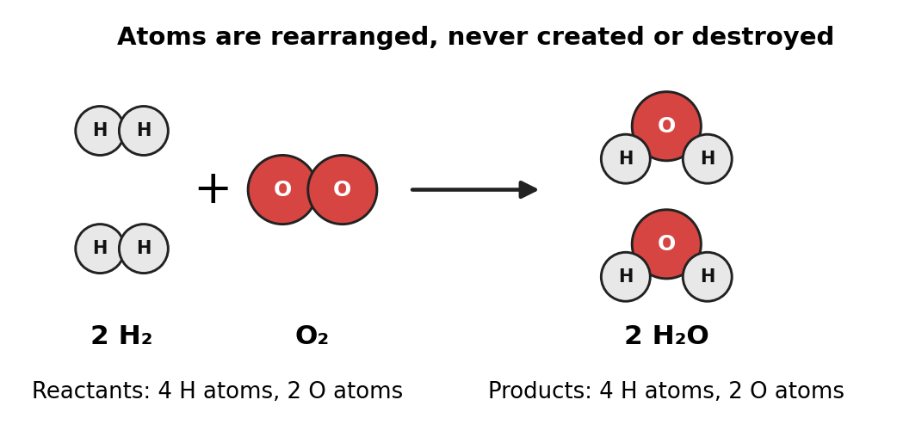
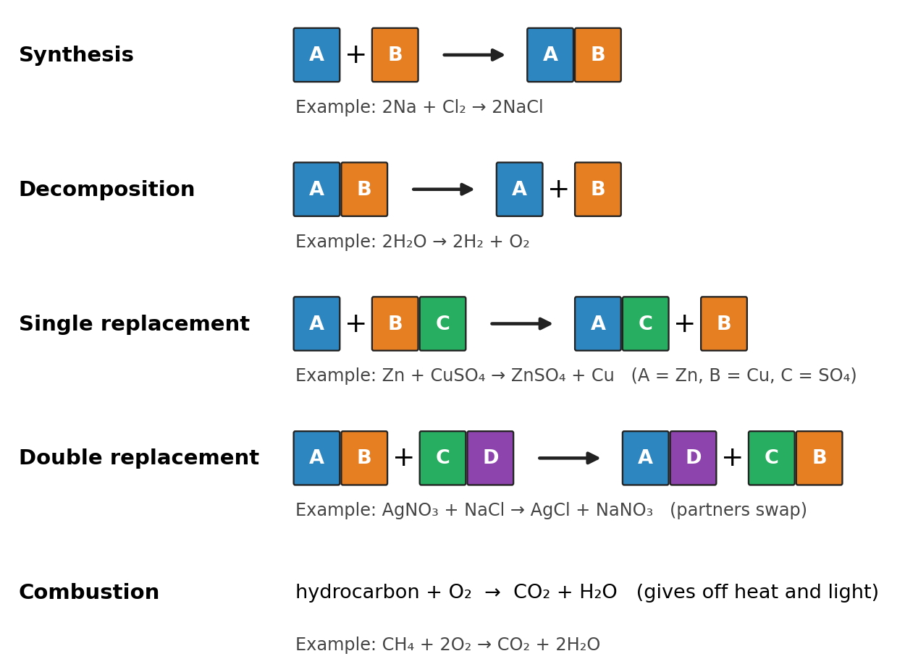
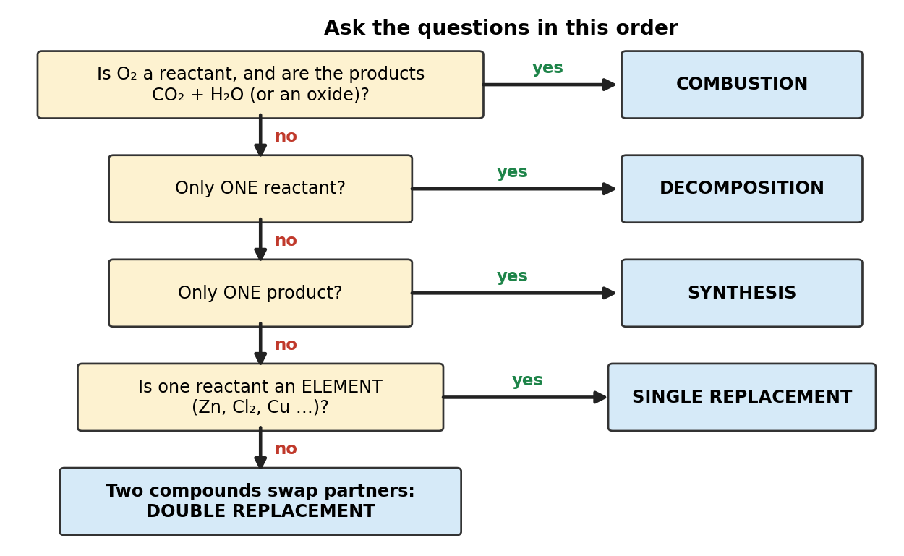

# Session C6: Chemical Reactions I — Evidence, Equations, Balancing and the Five Reaction Types

**Duration:** 45 minutes\
**Continues from:** Sessions C1–C5. The teacher's Units 1–3 (atomic structure, periodic trends, chemical bonding) are done. Writing correct formulas from names (C1, C2) is the skill this unit is built on: an equation with a wrong formula can't be balanced correctly.\
**School unit:** "Chemical Reactions and Equations", the first unit after bonding. Stoichiometry (moles and mass relationships) follows it.\
**Grade-9/10 foundation:** NCERT Class 9 *Atoms and Molecules* (the law of conservation of mass); NCERT Class 10 Ch1 *Chemical Reactions and Equations* (writing and balancing equations; combination, decomposition, displacement and double displacement reactions).\
**Grade-11 depth:** NCERT Class 11 Ch1 *Some Basic Concepts of Chemistry* (laws of chemical combination). US textbook equivalent: the "Chemical Equations and Reactions" chapter of HMH *Modern Chemistry* (describing reactions, the types of reactions, the activity series).

**NCERT and US names for the same reactions:**

| NCERT (India) | US (Dhairya's school) |
| --- | --- |
| combination | synthesis |
| decomposition | decomposition |
| displacement | single replacement |
| double displacement | double replacement |
| (burning, oxidation) | combustion |

---

## Lesson Plan

**Objectives.** By the end of this session Dhairya should be able to:

1. Tell a chemical change from a physical one, and list the five kinds of evidence for a chemical reaction.
2. State the **law of conservation of mass** and explain it with atoms.
3. Turn a word equation into a skeleton equation, then **balance** it by changing coefficients only, checking with an atom-count table.
4. Classify a reaction as **synthesis, decomposition, single replacement, double replacement or combustion**.
5. **Predict the products** of each type, using the activity series and the solubility rules.

| Time | Segment |
| --- | --- |
| 0–4 min | Warm-up: write 5 formulas from names |
| 4–10 min | Part 1: physical vs chemical change, evidence of a reaction |
| 10–25 min | Part 2: conservation of mass, writing and balancing equations |
| 25–40 min | Part 3: the five reaction types and predicting products |
| 40–45 min | Exit ticket, assign homework |

**Pacing note.** Part 2 is the core skill: do all four worked examples even if Part 3 gets shorter. If time is short, do synthesis, decomposition and combustion in class and set the activity series and solubility rules (single and double replacement) as reading with homework Q13 and Q14; they come back at the start of C7.

---

## Warm-up (4 min)

Write the formula of each compound.

1. calcium chloride → **CaCl₂** (Ca²⁺ and Cl⁻: two Cl⁻ balance one Ca²⁺)
2. aluminum sulfate → **Al₂(SO₄)₃** (Al³⁺ and SO₄²⁻: 2 × (+3) + 3 × (−2) = 0, and the parentheses keep the polyatomic ion together)
3. dinitrogen tetroxide → **N₂O₄** (molecular: the prefixes give the numbers)
4. sodium hydroxide → **NaOH**
5. iron(III) oxide → **Fe₂O₃** (the Roman numeral gives Fe³⁺)

**Bridge to today:** every equation below starts from formulas like these. Once a formula is correct, its subscripts are fixed. Balancing never changes them.

---

## Part 1 — Physical vs Chemical Change (6 min)

A **physical change** alters the form or state of a substance but not its identity: melting ice is still H₂O. A **chemical change** (a chemical reaction) produces **new substances** with new properties: iron rusting becomes iron oxide.

### Evidence that a chemical reaction has happened

| Evidence | Example |
| --- | --- |
| A **gas** is produced (bubbles) that wasn't there before | zinc in hydrochloric acid gives hydrogen gas |
| A **precipitate** forms: a solid appears when two solutions are mixed | lead(II) nitrate + potassium iodide gives yellow solid PbI₂ |
| A **color change** | a copper roof turning green |
| An **energy change**: the mixture gets hot or cold, or gives off light | a burning candle; an instant cold pack |
| A new **odor** | milk going sour |

**Careful: evidence is a clue, not proof.** Boiling water makes bubbles, but the gas is still H₂O, so boiling is physical. Dissolving salt in water can feel slightly cold, yet no new substance forms. The real test is always: **is a new substance made?**

---

## Part 2 — Conservation of Mass, Writing and Balancing Equations (15 min)

### The law of conservation of mass (Lavoisier, 1789)

> **Law of conservation of mass.** In a chemical reaction, matter is neither created nor destroyed: the total mass of the products equals the total mass of the reactants.
> $$\text{mass of reactants} = \text{mass of products}$$

**Why it is true.** A reaction breaks bonds and makes new ones. The **atoms** are rearranged into new substances, but every atom that goes in comes out. Same atoms, same mass.

{width=85%}

**Example.** Heating 10.0 g of calcium carbonate gives 5.60 g of calcium oxide and carbon dioxide gas. How much CO₂ is made?

- 10.0 g = 5.60 g + mass of CO₂, so mass of CO₂ = **4.40 g**.
- In an open container the mass seems to drop, because the CO₂ escapes into the air. In a sealed container the mass stays exactly 10.0 g.

### Parts of a chemical equation

2H₂(g) + O₂(g) → 2H₂O(l)

- **Reactants** on the left, **products** on the right; **→** means "yields", **+** separates substances.
- **Coefficients** (the big numbers in front, like the 2s) count units of each substance. A coefficient of 1 is not written.
- **Subscripts** (the small numbers, like the ₂ in H₂O) are part of the formula. **Changing a subscript makes a different substance**: H₂O₂ is hydrogen peroxide, not water.
- **State symbols:** (s) solid, (l) liquid, (g) gas, (aq) aqueous (dissolved in water).
- Conditions go over the arrow: Δ means heat is supplied; a catalyst's formula can be written there too.

### The seven diatomic elements

Seven elements exist as two-atom molecules whenever they are on their own (not in a compound): **H₂, N₂, O₂, F₂, Cl₂, Br₂, I₂**. Memory aid: **HOFBrINCl** (say "Hof-brin-kle"): H, O, F, Br, I, N, Cl. On the periodic table they make a "7" shape starting at element 7 (nitrogen), plus hydrogen.

So "oxygen gas" is always O₂, and "chlorine" as a reactant is always Cl₂.

### From words to a balanced equation

1. **Word equation:** hydrogen + oxygen → water
2. **Skeleton equation** (correct formulas, not balanced yet): H₂ + O₂ → H₂O
3. **Balanced equation:** 2H₂ + O₂ → 2H₂O

### The balancing method

1. Write correct formulas. **Never change a subscript** after this step.
2. Make an **atom-count table** for both sides.
3. Balance **metals** first, then **nonmetals other than H and O**.
4. If a **polyatomic ion** (SO₄²⁻, NO₃⁻, PO₄³⁻ …) appears unchanged on both sides, balance it **as one unit**.
5. Balance **hydrogen**, then **oxygen** last (O often appears in several substances, so it is easiest at the end).
6. Re-count every atom. Make sure the coefficients are the **lowest whole numbers** (divide through if they share a factor).

### Worked Example 1: H₂ + O₂ → H₂O

| Atom | Left | Right |
| --- | --- | --- |
| H | 2 | 2 |
| O | 2 | 1 ✗ |

- O is unbalanced. Put 2 in front of H₂O: H₂ + O₂ → **2**H₂O. Now O is 2 = 2, but H is 2 on the left and 4 on the right.
- Put 2 in front of H₂: **2**H₂ + O₂ → 2H₂O. H: 4 = 4, O: 2 = 2 ✓

**Answer: 2H₂ + O₂ → 2H₂O**

### Worked Example 2: Al + O₂ → Al₂O₃

- O: 2 on the left, 3 on the right. The lowest common multiple of 2 and 3 is **6**: put 3 in front of O₂ and 2 in front of Al₂O₃ → Al + **3**O₂ → **2**Al₂O₃.
- Al: now 4 on the right, so put 4 in front of Al.

| Atom | Left | Right |
| --- | --- | --- |
| Al | 4 | 2 × 2 = 4 ✓ |
| O | 3 × 2 = 6 | 2 × 3 = 6 ✓ |

**Answer: 4Al + 3O₂ → 2Al₂O₃**

### Worked Example 3: Pb(NO₃)₂ + KI → PbI₂ + KNO₃ (keep NO₃ as one unit)

- Pb: 1 = 1 ✓. NO₃ is unchanged on both sides, so count it as a unit: 2 on the left, 1 on the right. Put 2 in front of KNO₃.
- Now K is 2 on the right, so put 2 in front of KI. I: 2 = 2 ✓

| Unit | Left | Right |
| --- | --- | --- |
| Pb | 1 | 1 ✓ |
| NO₃ | 2 | 2 ✓ |
| K | 2 | 2 ✓ |
| I | 2 | 2 ✓ |

**Answer: Pb(NO₃)₂ + 2KI → PbI₂ + 2KNO₃.** This is the yellow-precipitate reaction from Part 1.

### Worked Example 4: combustion of propane, C₃H₈ + O₂ → CO₂ + H₂O

- **C first:** 3 on the left, so 3CO₂.
- **H next:** 8 on the left, so 4H₂O (4 × 2 = 8).
- **O last:** right side has 3 × 2 + 4 × 1 = 10 O atoms, so we need 5O₂.

| Atom | Left | Right |
| --- | --- | --- |
| C | 3 | 3 ✓ |
| H | 8 | 4 × 2 = 8 ✓ |
| O | 5 × 2 = 10 | 3 × 2 + 4 = 10 ✓ |

**Answer: C₃H₈ + 5O₂ → 3CO₂ + 4H₂O**

**The fraction trick (ethane).** C₂H₆ + O₂ → CO₂ + H₂O. C gives 2CO₂, H gives 3H₂O, so the right side has 2 × 2 + 3 = 7 O atoms. That needs 7/2 O₂, a fraction. Write C₂H₆ + 7/2 O₂ → 2CO₂ + 3H₂O, then **double everything**: **2C₂H₆ + 7O₂ → 4CO₂ + 6H₂O**.

---

## Part 3 — The Five Reaction Types (15 min)

{width=100%}

### 1. Synthesis (combination): A + B → AB

Two or more substances combine into **one** product.

- 2Na + Cl₂ → 2NaCl (metal + nonmetal gives an ionic compound)
- CaO + H₂O → Ca(OH)₂ (metal oxide + water gives a base)

**Predicting:** metal + nonmetal → ionic compound. Use the ion charges to write its formula, then balance.

### 2. Decomposition: AB → A + B

**One** reactant breaks into two or more products, usually when energy (heat, electricity, light) is supplied.

- 2H₂O → 2H₂ + O₂ (electrolysis)
- CaCO₃ → CaO + CO₂ (heating a metal carbonate gives a metal oxide + carbon dioxide)
- 2KClO₃ → 2KCl + 3O₂ (heating a chlorate gives a chloride + oxygen)

### 3. Single replacement (displacement): A + BC → AC + B

An **element** replaces another element in a compound. A metal replaces a metal (or hydrogen in an acid); a halogen replaces a halogen.

**It only happens if the free element is more reactive than the one it replaces.** The activity series ranks them:

| Metals, most to least reactive | Halogens |
| --- | --- |
| Li > K > Ba > Ca > Na > Mg > Al > Zn > Fe > Ni > Sn > Pb > **(H)** > Cu > Ag > Au | F₂ > Cl₂ > Br₂ > I₂ |

- **Zn + CuSO₄ → ZnSO₄ + Cu.** Zn is above Cu, so it reacts: the blue solution fades and copper metal coats the zinc.
- **Cu + ZnSO₄ → no reaction.** Cu is below Zn.
- **Mg + 2HCl → MgCl₂ + H₂.** Metals above (H) replace hydrogen in acids and give hydrogen gas. Cu, Ag and Au, below H, do not react with HCl.
- **Cl₂ + 2NaBr → 2NaCl + Br₂.** Cl₂ is above Br₂.

**Why the series works.** Reacting means losing electrons (for metals). A metal higher in the series gives up its electrons more easily, so it ends up as the ion and pushes the less reactive metal out of solution as the element. This links back to Unit 2: down a group, ionization energy falls and the metals become more reactive (Na reacts faster than Li, K faster than Na).

### 4. Double replacement (double displacement): AB + CD → AD + CB

Two ionic compounds in solution **swap partners**. The positive ion of each pairs with the negative ion of the other.

It only happens if one product is a **precipitate**, a **gas**, or **water**. Otherwise all the ions just stay dissolved and nothing changes.

- **Precipitate:** AgNO₃(aq) + NaCl(aq) → AgCl(s) + NaNO₃(aq)
- **Water (neutralization):** HCl(aq) + NaOH(aq) → NaCl(aq) + H₂O(l)
- **Gas:** Na₂CO₃ + 2HCl → 2NaCl + H₂O + CO₂ (the H₂CO₃ formed breaks down into H₂O and CO₂)

**Short solubility rules** (to decide whether a product is a precipitate):

| Usually soluble (stays aqueous) | Exceptions |
| --- | --- |
| all Group 1 (Li⁺, Na⁺, K⁺) and NH₄⁺ compounds | none |
| all nitrates (NO₃⁻) and acetates (CH₃COO⁻) | none |
| chlorides, bromides, iodides | Ag⁺, Pb²⁺, Hg₂²⁺ compounds are insoluble |
| sulfates (SO₄²⁻) | BaSO₄, PbSO₄, CaSO₄ (slightly), SrSO₄ |
| **Usually insoluble (precipitate)** | **Exceptions** |
| carbonates, phosphates, sulfides | Group 1 and NH₄⁺ compounds are soluble |
| hydroxides (OH⁻) | Group 1 soluble; Ca(OH)₂ and Ba(OH)₂ slightly soluble |

### 5. Combustion: fuel + O₂ → CO₂ + H₂O

A substance reacts rapidly with **oxygen**, releasing heat and light. For a **hydrocarbon** (C and H only) the products are always **CO₂ and H₂O** when there is plenty of oxygen.

- CH₄ + 2O₂ → CO₂ + 2H₂O (natural gas)
- With too little oxygen, **incomplete combustion** gives carbon monoxide (CO, a poisonous gas) and soot (C) instead of CO₂.

**Overlap:** 2Mg + O₂ → 2MgO is a combustion (Mg burns with a bright white flame) **and** a synthesis (one product). Your teacher may accept either, but name both if you aren't sure.

### How to identify the type

{width=96%}

---

## Exit Ticket (3 min)

1. Balance: Fe + O₂ → Fe₂O₃
2. Classify, then predict the products and balance: Mg + CuCl₂ → ?
3. Does silver react with hydrochloric acid? Why or why not?

---

## Practice Problems

*Show an atom-count table for every balancing question. Do Q7, Q12 and Q13 in class if time allows; the rest are homework.*

**Tier 1 — Balance**

1. N₂ + H₂ → NH₃
2. Na + Cl₂ → NaCl
3. KClO₃ → KCl + O₂
4. Fe + Cl₂ → FeCl₃
5. CH₄ + O₂ → CO₂ + H₂O

**Tier 2 — Balance (harder)**

6. Al + HCl → AlCl₃ + H₂
7. Ca(OH)₂ + H₃PO₄ → Ca₃(PO₄)₂ + H₂O
8. Fe₂O₃ + CO → Fe + CO₂
9. C₂H₆ + O₂ → CO₂ + H₂O
10. C₆H₁₂O₆ + O₂ → CO₂ + H₂O (cellular respiration)

**Tier 3 — Classify, predict, react or not**

11. **Classify** each reaction: (a) 2Mg + O₂ → 2MgO (b) 2H₂O₂ → 2H₂O + O₂ (c) Zn + 2AgNO₃ → Zn(NO₃)₂ + 2Ag (d) BaCl₂ + Na₂SO₄ → BaSO₄ + 2NaCl (e) C₃H₈ + 5O₂ → 3CO₂ + 4H₂O
12. **Predict the products and balance:** (a) Li + O₂ (b) Mg + HCl (c) AgNO₃ + KBr (d) C₄H₁₀ + O₂ (e) CaCO₃, heated (f) Cl₂ + KI
13. **Will it react?** Use the activity series. If yes, write the balanced equation. (a) Cu + AgNO₃ (b) Ag + CuSO₄ (c) Fe + HCl (iron forms Fe²⁺) (d) I₂ + NaCl (e) Zn + Pb(NO₃)₂
14. **Word equations:** write the balanced equation with state symbols, and name the type. (a) Solid sodium reacts with water to form aqueous sodium hydroxide and hydrogen gas. (b) Aqueous lead(II) nitrate reacts with aqueous potassium iodide to form solid lead(II) iodide and aqueous potassium nitrate. (c) Aluminum metal is placed in aqueous copper(II) chloride, forming aqueous aluminum chloride and copper metal.

**Tier 4 — Reasoning and challenge**

15. **Conservation of mass:** 2.43 g of magnesium burns completely in oxygen and forms 4.03 g of magnesium oxide. (a) What mass of oxygen reacted? (b) A student mixes baking soda and vinegar in an open beaker on a balance and sees the mass go down. Does this break the law of conservation of mass? Explain.
16. **Chemical or physical?** Give your reason for each. (a) Ice melts at 0 °C. (b) An Alka-Seltzer tablet fizzes in water. (c) Water boils and bubbles. (d) Two clear solutions are mixed and a yellow solid appears. (e) A light bulb filament glows and gets hot.
17. **Challenge — balance:** (a) C₈H₁₈ + O₂ → CO₂ + H₂O (octane in gasoline) (b) NH₃ + O₂ → NO + H₂O

---

## Answer Key — Full Step-by-Step Solutions

**Exit ticket**

1. O: LCM of 2 and 3 is 6, so 3O₂ and 2Fe₂O₃; then Fe: 4 on the right, so 4Fe. **4Fe + 3O₂ → 2Fe₂O₃** (Fe 4 = 4, O 6 = 6 ✓).
2. **Single replacement.** Mg is above Cu in the activity series, so Mg replaces Cu: **Mg + CuCl₂ → MgCl₂ + Cu** (already balanced: Mg 1, Cu 1, Cl 2 on each side).
3. **No.** Silver is below hydrogen in the activity series, so it can't replace hydrogen in HCl.

**1.** N₂ + 3H₂ → 2NH₃

- N: 2 on the left, so 2NH₃. H: now 6 on the right, so 3H₂.

| Atom | Left | Right |
| --- | --- | --- |
| N | 2 | 2 ✓ |
| H | 6 | 6 ✓ |

**2.** 2Na + Cl₂ → 2NaCl

- Cl: 2 on the left, so 2NaCl. Na: now 2 on the right, so 2Na. Na 2 = 2, Cl 2 = 2 ✓

**3.** 2KClO₃ → 2KCl + 3O₂

- O: 3 on the left, 2 on the right; LCM 6, so 2KClO₃ and 3O₂. Then K and Cl: 2 on the left, so 2KCl.

| Atom | Left | Right |
| --- | --- | --- |
| K | 2 | 2 ✓ |
| Cl | 2 | 2 ✓ |
| O | 6 | 6 ✓ |

**4.** 2Fe + 3Cl₂ → 2FeCl₃

- Cl: 2 on the left, 3 on the right; LCM 6, so 3Cl₂ and 2FeCl₃. Then Fe: 2Fe. Fe 2 = 2, Cl 6 = 6 ✓

**5.** CH₄ + 2O₂ → CO₂ + 2H₂O

- C: 1 = 1. H: 4 on the left, so 2H₂O. O: right side 2 + 2 = 4, so 2O₂.

| Atom | Left | Right |
| --- | --- | --- |
| C | 1 | 1 ✓ |
| H | 4 | 4 ✓ |
| O | 4 | 4 ✓ |

**6.** 2Al + 6HCl → 2AlCl₃ + 3H₂

- Cl: 1 on the left, 3 on the right, so 3HCl … but then H is 3 on the left and 2 on the right. LCM of 3 and 2 is 6: 6HCl and 3H₂. Now Cl is 6 on the left, so 2AlCl₃; then 2Al.

| Atom | Left | Right |
| --- | --- | --- |
| Al | 2 | 2 ✓ |
| H | 6 | 6 ✓ |
| Cl | 6 | 6 ✓ |

**7.** 3Ca(OH)₂ + 2H₃PO₄ → Ca₃(PO₄)₂ + 6H₂O

- Ca: 3 on the right, so 3Ca(OH)₂. PO₄ as a unit: 2 on the right, so 2H₃PO₄.
- H: left 3 × 2 + 2 × 3 = 12, so 6H₂O. O (outside PO₄): left 3 × 2 = 6 (from OH), right 6 (from H₂O) ✓

| Unit | Left | Right |
| --- | --- | --- |
| Ca | 3 | 3 ✓ |
| PO₄ | 2 | 2 ✓ |
| H | 6 + 6 = 12 | 12 ✓ |
| O in OH / H₂O | 6 | 6 ✓ |

(This is a neutralization: an acid plus a base gives a salt plus water.)

**8.** Fe₂O₃ + 3CO → 2Fe + 3CO₂

- Fe: 2Fe. Each CO picks up one O from Fe₂O₃ to become CO₂, and Fe₂O₃ has 3 O to give, so 3CO and 3CO₂.

| Atom | Left | Right |
| --- | --- | --- |
| Fe | 2 | 2 ✓ |
| C | 3 | 3 ✓ |
| O | 3 + 3 = 6 | 3 × 2 = 6 ✓ |

**9.** 2C₂H₆ + 7O₂ → 4CO₂ + 6H₂O (the fraction trick: 7/2 O₂, then double everything)

| Atom | Left | Right |
| --- | --- | --- |
| C | 4 | 4 ✓ |
| H | 12 | 12 ✓ |
| O | 14 | 8 + 6 = 14 ✓ |

**10.** C₆H₁₂O₆ + 6O₂ → 6CO₂ + 6H₂O

- C: 6CO₂. H: 12, so 6H₂O. O on the right: 12 + 6 = 18. Glucose already supplies 6, so O₂ must supply 12: 6O₂.

| Atom | Left | Right |
| --- | --- | --- |
| C | 6 | 6 ✓ |
| H | 12 | 12 ✓ |
| O | 6 + 12 = 18 | 12 + 6 = 18 ✓ |

**11. Classify**

- **(a)** Synthesis (one product); also the combustion of magnesium.
- **(b)** Decomposition (one reactant).
- **(c)** Single replacement (the element Zn replaces Ag).
- **(d)** Double replacement (BaSO₄ is the precipitate).
- **(e)** Combustion (hydrocarbon + O₂ → CO₂ + H₂O).

**12. Predict and balance**

- **(a)** Synthesis: Li⁺ and O²⁻ give Li₂O. **4Li + O₂ → 2Li₂O**
- **(b)** Single replacement: Mg is above H. **Mg + 2HCl → MgCl₂ + H₂**
- **(c)** Double replacement: AgBr is insoluble (Ag⁺ halide). **AgNO₃ + KBr → AgBr(s) + KNO₃**
- **(d)** Combustion: C gives 4CO₂, H gives 5H₂O, so O = 8 + 5 = 13, i.e. 13/2 O₂; double: **2C₄H₁₀ + 13O₂ → 8CO₂ + 10H₂O**
- **(e)** Decomposition of a carbonate: **CaCO₃ → CaO + CO₂**
- **(f)** Single replacement: Cl₂ is above I₂. **Cl₂ + 2KI → 2KCl + I₂**

**13. Will it react?**

- **(a) Yes**, Cu is above Ag: **Cu + 2AgNO₃ → Cu(NO₃)₂ + 2Ag**
- **(b) No**, Ag is below Cu.
- **(c) Yes**, Fe is above H: **Fe + 2HCl → FeCl₂ + H₂**
- **(d) No**, I₂ is below Cl₂, so it can't replace chloride.
- **(e) Yes**, Zn is above Pb: **Zn + Pb(NO₃)₂ → Zn(NO₃)₂ + Pb**

**14. Word equations**

- **(a)** 2Na(s) + 2H₂O(l) → 2NaOH(aq) + H₂(g). **Single replacement** (Na replaces one H in water). Check: Na 2 = 2, H 4 = 2 + 2, O 2 = 2 ✓
- **(b)** Pb(NO₃)₂(aq) + 2KI(aq) → PbI₂(s) + 2KNO₃(aq). **Double replacement** (Worked Example 3).
- **(c)** 2Al(s) + 3CuCl₂(aq) → 2AlCl₃(aq) + 3Cu(s). **Single replacement.** Cl: LCM of 2 and 3 is 6, so 3CuCl₂ and 2AlCl₃; then 2Al and 3Cu. Al 2 = 2, Cu 3 = 3, Cl 6 = 6 ✓

**15. Conservation of mass**

- **(a)** mass of Mg + mass of O₂ = mass of MgO, so mass of O₂ = 4.03 − 2.43 = **1.60 g**.
- **(b)** **No.** The reaction makes CO₂ gas, which escapes from the open beaker, so the balance doesn't weigh it. In a sealed container the total mass stays the same.

**16. Chemical or physical?**

- **(a) Physical:** still H₂O, only the state changes.
- **(b) Chemical:** a new gas (CO₂) is produced by a reaction.
- **(c) Physical:** the bubbles are water vapor, the same substance.
- **(d) Chemical:** a precipitate, a new solid substance (for example PbI₂).
- **(e) Physical:** the filament is still tungsten; electrical energy becomes heat and light without a new substance.

**17. Challenge**

- **(a)** C: 8CO₂. H: 18, so 9H₂O. O on the right: 16 + 9 = 25, so 25/2 O₂. Double everything: **2C₈H₁₈ + 25O₂ → 16CO₂ + 18H₂O** (C 16, H 36, O 50 on each side).
- **(b)** H: 3 in NH₃ and 2 in H₂O; LCM 6, so 2NH₃ and 3H₂O. N: 2NO. O on the right: 2 + 3 = 5, so 5/2 O₂. Double everything: **4NH₃ + 5O₂ → 4NO + 6H₂O** (N 4, H 12, O 10 on each side).

---

## The 8 mistakes that cost the most marks

1. **Changing a subscript to balance** (writing H₂O₂ to fix the oxygen). Only coefficients change.
2. **Forgetting diatomic elements:** writing O or Cl as a reactant instead of O₂ or Cl₂.
3. **Wrong formulas before balancing:** e.g. AlCl instead of AlCl₃. Get the charges right first.
4. **Splitting a polyatomic ion** that appears unchanged on both sides, which makes the counting much harder.
5. **Leaving coefficients that can be divided**, like 4H₂ + 2O₂ → 4H₂O. Reduce to 2H₂ + O₂ → 2H₂O.
6. **Writing a single replacement that can't happen.** Check the activity series first.
7. **Writing a double replacement with no driving force.** If no precipitate, gas or water forms, there is no reaction.
8. **Treating evidence as proof:** bubbles from boiling water are not a chemical change.

---

## Notes for next session

- **C7 — Predicting products in depth:** more practice with the activity series and solubility rules, then **net ionic equations** and **spectator ions** (a Gifted-level topic in this unit). Example: AgNO₃(aq) + NaCl(aq) → AgCl(s) + NaNO₃(aq) becomes Ag⁺(aq) + Cl⁻(aq) → AgCl(s), because Na⁺ and NO₃⁻ don't change.
- **C8 — Oxidation numbers and redox:** which atoms lose and gain electrons in single replacement and combustion, then a Unit 4 review and practice test.
- **Then Unit 5, stoichiometry:** the mole (Avogadro's number, molar mass, conversions), percent composition and empirical formulas, mole ratios and mass-to-mass problems, limiting reactant and percent yield. Today's coefficients will be read as **mole ratios**.
