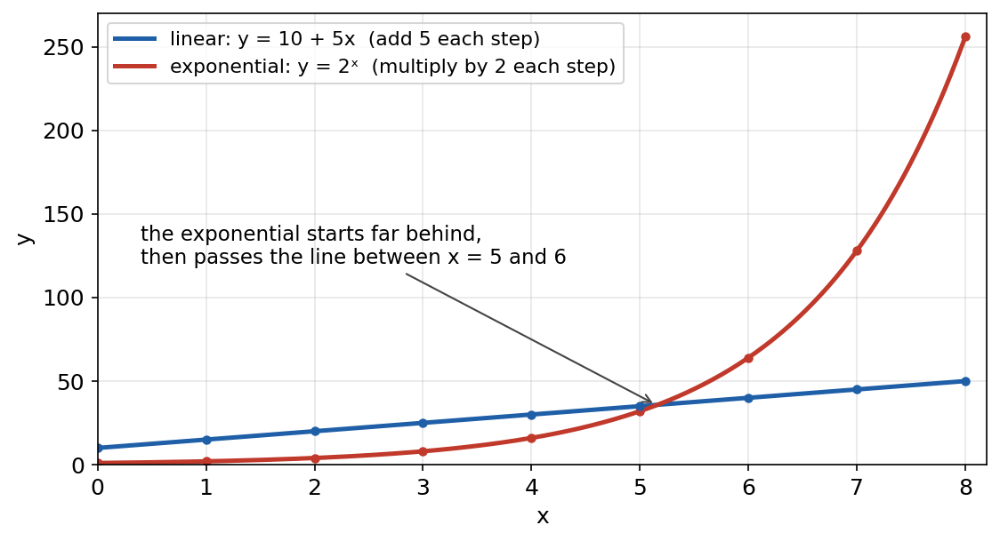
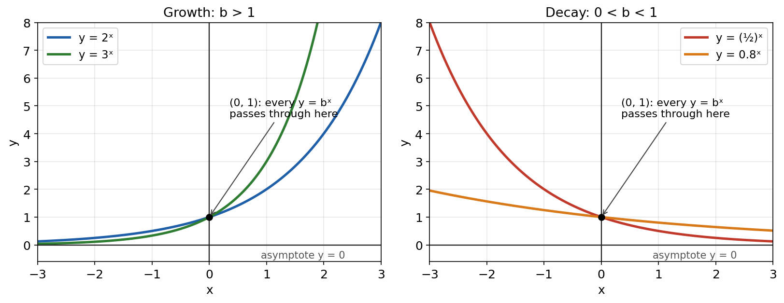
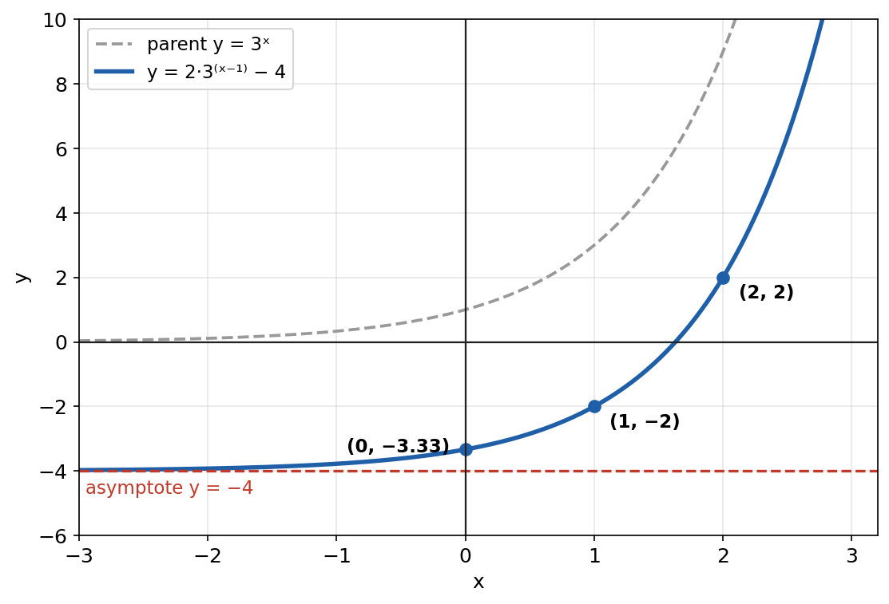

# Session M4 — Exponential Functions: Growth, Decay and Their Graphs

**Duration:** 45 minutes\
**Continues from:** Session M1 (laws of exponents, rational exponents, same-base exponential equations, hidden quadratics) and the midterm review M3. Midterm score 94/100, so the pace is brisk and Tier 4 is a real challenge.\
**School unit:** Unit 2, "Exponential and Logarithmic Functions" (Georgia standard AA.FGR.3: inverse functions, exponential and logarithmic graphs, logarithm properties, modeling). This session is the first of the unit.\
**Foundation:** R.D. Sharma *Exponents of Real Numbers* (laws of exponents), already covered in M1.\
**School textbook:** Big Ideas *Advanced Algebra with CalcChat and CalcView* (Larson & Boswell), chapter "Exponential and Logarithmic Functions": the lessons on exponential growth and decay functions, and the natural base e.\
**Why now:** Unit 2 starts when school resumes. Every later idea in the unit (inverse functions, logarithms, solving exponential equations) is built on the functions introduced today.

---

## Lesson Plan

**Objectives.** By the end of this session the student should be able to:

1. Tell a linear pattern (constant difference) from an exponential one (constant ratio).
2. Define $f(x) = a \cdot b^x$, explain the restrictions on b, and state its key features.
3. Write growth and decay models $y = a(1 + r)^t$ and $y = a(1 - r)^t$, including half-life and doubling time.
4. Derive and use the compound-interest formula, and explain where e comes from.
5. Graph $y = a \cdot b^{x - h} + k$ from its asymptote and anchor points.
6. Write an exponential function through two points, and solve equations by a common base.

| Time | Segment |
| --- | --- |
| 0–4 min | Warm-up: 4 exponent questions |
| 4–14 min | Part 1: linear vs exponential, the definition and key features |
| 14–27 min | Part 2: growth and decay models, compound interest and e |
| 27–35 min | Part 3: graphs and transformations |
| 35–40 min | Part 4: writing from two points, and solving |
| 40–45 min | Exit ticket, assign homework |

**Pacing note.** Part 2 carries the most weight on school tests (word problems). If time is short, cut Part 4 to the first two-point example and set the rest as homework Q11–Q13.

---

## Warm-up (4 min)

1. Simplify $(2x^3)^2 \cdot x^{-4}$. → $4x^6 \cdot x^{-4} = 4x^2$
2. Evaluate $32^{3/5}$. → $(\sqrt[5]{32})^3 = 2^3 = 8$
3. Evaluate $5^0 + 4^{-1/2}$. → $1 + \frac{1}{\sqrt{4}} = 1 + \frac{1}{2} = \frac{3}{2}$
4. Solve $3^{x + 2} = 81$. → $81 = 3^4$, so $x + 2 = 4$ and $x = 2$

**Bridge to today:** so far the exponent was a fixed number or the unknown in an equation. Today the exponent becomes the **input** of a function: $f(x) = 2^x$.

---

## Part 1 — Linear vs Exponential (10 min)

### Constant difference vs constant ratio

| x | 0 | 1 | 2 | 3 | 4 |
| --- | --- | --- | --- | --- | --- |
| $f(x) = 3x + 2$ | 2 | 5 | 8 | 11 | 14 |
| $g(x) = 2 \cdot 3^x$ | 2 | 6 | 18 | 54 | 162 |

- f **adds 3** each time x goes up by 1: a constant **difference**. That is a linear function.
- g **multiplies by 3** each time x goes up by 1: a constant **ratio**. That is an exponential function.

**Test for a table with equally spaced x-values:** subtract consecutive y-values (all equal → linear); divide them (all equal → exponential).

{width=80%}

### Definition

> An **exponential function** has the form
> $$f(x) = a \cdot b^x, \qquad a \ne 0,\; b > 0,\; b \ne 1$$
> a is the **initial value** ($f(0) = a \cdot b^0 = a$) and b is the **base**, the constant ratio (the growth or decay factor).

**Why these restrictions on b:**

- **b > 0:** with a negative base, $(-2)^{1/2} = \sqrt{-2}$ is not a real number, so the function would have gaps; and its values would flip sign at every whole number: $(-2)^1 = -2$, $(-2)^2 = 4$.
- **b ≠ 1:** $1^x = 1$ for every x, which is a constant (linear) function, not an exponential one.
- **a ≠ 0:** $0 \cdot b^x = 0$ for every x.

### Growth and decay

{width=100%}

| Key feature (for $a > 0$) | Value | Reason |
| --- | --- | --- |
| y-intercept | $(0, a)$ | $b^0 = 1$ |
| Horizontal asymptote | $y = 0$ | $b^x$ gets closer and closer to 0 but never reaches it |
| Domain | all real numbers | any real power of a positive number is defined |
| Range | $y > 0$ | a positive number to any power is positive |
| Growth or decay | growth if $b > 1$ (increasing); decay if $0 < b < 1$ (decreasing) | multiplying by more than 1 increases, by less than 1 decreases |
| End behavior (growth) | $y \to \infty$ as $x \to \infty$; $y \to 0$ as $x \to -\infty$ | |
| End behavior (decay) | $y \to 0$ as $x \to \infty$; $y \to \infty$ as $x \to -\infty$ | |

If $a < 0$, the graph is reflected across the x-axis: the range becomes $y < 0$.

---

## Part 2 — Growth and Decay Models (13 min)

### Derivation: the percent model

A quantity starts at a and grows by a fixed percent r (as a decimal) each period.

- After 1 period: $a + ar = a(1 + r)$.
- After 2 periods: $a(1 + r) \cdot (1 + r) = a(1 + r)^2$.
- After t periods: multiply by $(1 + r)$ t times:

$$\text{growth: } y = a(1 + r)^t \qquad\qquad \text{decay: } y = a(1 - r)^t$$

The **growth factor** is $b = 1 + r$; the **decay factor** is $b = 1 - r$. Read the rate back from the base: $b = 1.07$ means growth of 7%; $b = 0.85$ means decay of 15% (because $1 - 0.85 = 0.15$).

### Worked Example 1: population growth

A town of 12,000 people grows 3% per year. Write a model and predict the population after 10 years.

- $a = 12\,000$, $r = 0.03$, so $P(t) = 12\,000(1.03)^t$.
- $P(10) = 12\,000(1.03)^{10} = 12\,000 \times 1.3439 = 16\,127$ people.

### Worked Example 2: depreciation

A car bought for \$28,000 loses 15% of its value each year. Find its value after 5 years.

- Decay factor $b = 1 - 0.15 = 0.85$: $V(t) = 28\,000(0.85)^t$.
- $V(5) = 28\,000(0.85)^5 = 28\,000 \times 0.44371$ = \$12,423.75.

### Half-life and doubling time

If a quantity halves every h time units, then after t units it has halved $t/h$ times:

$$y = a\left(\tfrac{1}{2}\right)^{t/h} \qquad\qquad \text{and if it doubles every } d: \quad y = a \cdot 2^{t/d}$$

**Worked Example 3.** A 400 mg dose of a medicine has a half-life of 6 hours.

- After 24 hours (4 half-lives): $400\left(\tfrac{1}{2}\right)^{24/6} = 400 \times \tfrac{1}{16} = 25$ mg.
- After 9 hours: $400\left(\tfrac{1}{2}\right)^{1.5} = 141$ mg. The exponent doesn't have to be a whole number.

**Worked Example 4.** A bacteria culture of 500 cells doubles every 20 minutes. After 2 hours (120 min) it has doubled $120/20 = 6$ times: $500 \cdot 2^6 = 32\,000$ cells.

### Derivation: compound interest

A principal P earns an annual rate r, compounded n times a year. Each compounding period pays a rate of $r/n$, so the money is multiplied by $(1 + r/n)$ each period. In t years there are $nt$ periods:

$$A = P\left(1 + \frac{r}{n}\right)^{nt}$$

**Worked Example 5.** \$5,000 is invested at 4% for 10 years.

| Compounding | n | Amount after 10 years |
| --- | --- | --- |
| annually | 1 | $5000(1.04)^{10}$ = \$7,401.22 |
| monthly | 12 | $5000(1 + 0.04/12)^{120}$ = \$7,454.16 |
| daily | 365 | $5000(1 + 0.04/365)^{3650}$ = \$7,458.96 |
| continuously | — | $5000e^{0.4}$ = \$7,459.12 |

More frequent compounding pays more, but the gain shrinks: it approaches a limit.

### Where the number e comes from

Invest \$1 at 100% interest for one year, compounded n times: $A = \left(1 + \frac{1}{n}\right)^n$.

| n | $\left(1 + \frac{1}{n}\right)^n$ |
| --- | --- |
| 1 | 2 |
| 2 | 2.25 |
| 4 | 2.4414 |
| 12 | 2.6130 |
| 365 | 2.7146 |
| 10,000 | 2.7181 |
| 1,000,000 | 2.7182805 |

The values level off at **e = 2.718281828…**, an irrational number like π. It is the most a dollar can grow in a year at 100% interest.

**Continuous compounding.** Write $m = n/r$, so $n = mr$ and $\frac{r}{n} = \frac{1}{m}$:

$$\left(1 + \frac{r}{n}\right)^{nt} = \left(1 + \frac{1}{m}\right)^{mrt} = \left[\left(1 + \frac{1}{m}\right)^m\right]^{rt}$$

As n grows without limit, so does m, and the bracket approaches e:

$$A = Pe^{rt}$$

---

## Part 3 — Graphs and Transformations (8 min)

$$y = a \cdot b^{x - h} + k$$

| Parameter | Effect on the graph of $y = b^x$ |
| --- | --- |
| h | shifts right by h (left if h is negative) |
| k | shifts up by k; the **asymptote moves to y = k** |
| \|a\| > 1 or < 1 | vertical stretch or shrink |
| a < 0 | reflection across the asymptote (over the x-axis before the shift) |

**Sketching method:**

1. Draw the asymptote $y = k$ as a dashed line.
2. Plot an anchor point at $x = h$: there $b^0 = 1$, so $y = a + k$.
3. Plot one or two more points (x = h + 1 and x = h − 1, or the y-intercept).
4. Draw the curve approaching the asymptote on one side.

**Worked Example 6.** Graph $y = 2 \cdot 3^{x - 1} - 4$.

- Asymptote $y = -4$; range $y > -4$; domain all real numbers.
- $x = 1$: $y = 2(1) - 4 = -2$. $x = 2$: $y = 2(3) - 4 = 2$. $x = 0$: $y = 2\left(\tfrac{1}{3}\right) - 4 = -\tfrac{10}{3} \approx -3.33$ (the y-intercept).
- The graph crosses the x-axis between $x = 1$ and $x = 2$, where $3^{x-1} = 2$. To find that x exactly, you need a logarithm (next session): $x = 1 + \log_3 2 \approx 1.63$.

{width=72%}

---

## Part 4 — Writing from Two Points, and Solving (5 min)

### Worked Example 7: two points

Find $y = a \cdot b^x$ through $(1, 6)$ and $(3, 54)$.

- Substitute both: $6 = ab$ and $54 = ab^3$.
- **Divide** the second by the first to cancel a: $\dfrac{ab^3}{ab} = \dfrac{54}{6}$, so $b^2 = 9$ and $b = 3$ (b must be positive).
- Then $a = 6/b = 2$. **Answer:** $y = 2 \cdot 3^x$. Check: $2 \cdot 3^3 = 54$ ✓

### Solving

- **Same base:** $8^x = 32$: $2^{3x} = 2^5$, so $x = \tfrac{5}{3}$.
- **Bases don't match:** when does the town in Example 1 double? Solve $1.03^t = 2$. A table gives $1.03^{23} = 1.974$ and $1.03^{24} = 2.033$, so it doubles **between 23 and 24 years**. The exact answer needs the **logarithm**, the inverse of an exponential function, which is next session: $t = \dfrac{\log 2}{\log 1.03} \approx 23.4$ years.

---

## Exit Ticket (3 min)

1. Is $y = 5(0.92)^t$ growth or decay? What is the percent rate?
2. \$2,000 is invested at 6% compounded quarterly. Find the amount after 3 years.
3. Give the asymptote and the range of $y = -3 \cdot 2^x + 5$.

---

## Practice Problems

*Calculator allowed. Round money to the cent. Do Q4, Q9 and Q12 in class if time allows; the rest are homework.*

**Tier 1 — Recognize and describe**

1. Growth or decay? Give the percent rate. (a) $y = 300(1.07)^t$ (b) $y = 50(0.6)^t$ (c) $y = 2(1.5)^x$ (d) $y = 900\left(\tfrac{1}{3}\right)^x$
2. For $f(x) = 4\left(\tfrac{1}{2}\right)^x$, give the y-intercept, asymptote, domain, range, whether it is increasing or decreasing, and $f(-2)$.
3. Linear, exponential or neither? (a) y: 5, 10, 20, 40 (b) y: 3, 7, 11, 15 (c) y: 1, 2, 4, 7 (x = 0, 1, 2, 3 in each).

**Tier 2 — Models**

4. A town of 8,500 people shrinks 2% per year. Write the model and find the population after 6 years.
5. A \$1,200 laptop loses 25% of its value each year. Find its value after 3 years.
6. \$3,000 is invested at 5% for 8 years. Find the amount if interest is compounded (a) annually, (b) monthly, (c) continuously.
7. Caffeine has a half-life of about 5 hours. You drink 200 mg at 8 a.m. How much remains at (a) 6 p.m., (b) 11 p.m.?
8. A video has 1,500 views, and its views double every 3 days. Write a model and find the views after 15 days.

**Tier 3 — Graphs, two points, solving**

9. Graph $y = 3 \cdot 2^{x + 1} - 6$. Give the asymptote, three points, the domain, the range, and both intercepts.
10. Describe how to get $y = -2^{x - 3} + 1$ from $y = 2^x$. Give its asymptote and range.
11. Write $y = ab^x$ through $(0, 7)$ and $(2, 63)$.
12. Write $y = ab^x$ through $(1, 10)$ and $(4, 80)$.
13. Solve: (a) $4^{x + 1} = 8^x$ (b) $\left(\tfrac{1}{9}\right)^x = 27$ (c) $5^{2x - 1} = 125$

**Tier 4 — Challenge**

14. **Two banks.** Bank A pays 6% compounded annually; Bank B pays 5.9% compounded monthly. Which is better for \$10,000 over 10 years, and by how much? Explain why the lower rate wins.
15. **Doubling time.** A town grows 4% per year. Use a table to find between which two whole years it doubles. Compare with the "rule of 72" estimate, 72 ÷ 4.
16. **Cooling coffee.** Coffee at 190°F sits in a 70°F room. Its temperature after t minutes is $T(t) = 70 + 120(0.95)^t$. (a) What does the asymptote mean here? (b) Find T(10). (c) After how many whole minutes is the coffee first below 120°F?

---

## Answer Key — Full Step-by-Step Solutions

**Exit ticket**

1. $b = 0.92 < 1$, so **decay**. $1 - 0.92 = 0.08$: **8% per period**.
2. $n = 4$, so the quarterly rate is $0.06/4 = 0.015$ over $4 \times 3 = 12$ quarters: $A = 2000(1.015)^{12}$ = **\$2,391.24**.
3. k = 5, so the asymptote is **y = 5**. a = −3 < 0 reflects the graph below the asymptote, so the range is **y < 5**.

**1. Growth or decay**

- **(a)** $b = 1.07 > 1$: growth, $r = 0.07$, **7%**.
- **(b)** $b = 0.6$: decay, $1 - 0.6 = 0.4$, **40%**.
- **(c)** $b = 1.5$: growth, **50%**.
- **(d)** $b = \tfrac{1}{3}$: decay, $1 - \tfrac{1}{3} = \tfrac{2}{3}$, **about 66.7%**.

**2.** $f(x) = 4\left(\tfrac{1}{2}\right)^x$

- y-intercept $(0, 4)$; asymptote $y = 0$; domain all real numbers; range $y > 0$; **decreasing** (b < 1).
- $f(-2) = 4\left(\tfrac{1}{2}\right)^{-2} = 4 \times 2^2 = 16$.

**3.** (a) Ratios $10/5 = 20/10 = 40/20 = 2$: **exponential**. (b) Differences all 4: **linear**. (c) Differences 1, 2, 3 and ratios 2, 2, 1.75: **neither**.

**4.** $P(t) = 8500(0.98)^t$, and $P(6) = 8500(0.98)^6 = 8500 \times 0.88584$ = **about 7,530 people**.

**5.** $V(3) = 1200(0.75)^3 = 1200 \times 0.421875$ = **\$506.25**.

**6.**

- **(a)** $3000(1.05)^8$ = **\$4,432.37**
- **(b)** $3000\left(1 + \tfrac{0.05}{12}\right)^{96}$ = **\$4,471.76**
- **(c)** $3000e^{0.05 \times 8} = 3000e^{0.4}$ = **\$4,475.47**

**7.** $A(t) = 200\left(\tfrac{1}{2}\right)^{t/5}$.

- **(a)** 6 p.m. is 10 hours later: $200\left(\tfrac{1}{2}\right)^2$ = **50 mg**.
- **(b)** 11 p.m. is 15 hours later: $200\left(\tfrac{1}{2}\right)^3$ = **25 mg**.

**8.** $V(t) = 1500 \cdot 2^{t/3}$. After 15 days: $1500 \cdot 2^5 = 1500 \times 32$ = **48,000 views**.

**9.** $y = 3 \cdot 2^{x + 1} - 6$

- Asymptote $y = -6$ (k = −6).
- Anchor at $x = -1$ (where the exponent is 0): $y = 3 - 6 = -3$. Also $x = 0$: $y = 3 \cdot 2 - 6 = 0$; $x = 1$: $y = 3 \cdot 4 - 6 = 6$.
- Domain all real numbers; range $y > -6$.
- The graph passes through the **origin**: the y-intercept is $(0, 0)$ and the x-intercept is $x = 0$.

**10.** Shift $y = 2^x$ **right 3**, **reflect it over the x-axis** (the minus sign is outside the power), then shift it **up 1**. Asymptote $y = 1$; because of the reflection the graph lies below it, so the range is $y < 1$.

**11.** $(0, 7)$ gives $a = 7$ directly ($b^0 = 1$). Then $63 = 7b^2$, so $b^2 = 9$ and $b = 3$. **$y = 7 \cdot 3^x$**

**12.** $10 = ab$ and $80 = ab^4$. Divide: $b^3 = 8$, so $b = 2$. Then $a = 10/2 = 5$. **$y = 5 \cdot 2^x$**. Check: $5 \cdot 2^4 = 80$ ✓

**13.**

- **(a)** $2^{2(x + 1)} = 2^{3x}$, so $2x + 2 = 3x$ and **x = 2**. Check: $4^3 = 64 = 8^2$ ✓
- **(b)** $3^{-2x} = 3^3$, so $-2x = 3$ and **$x = -\tfrac{3}{2}$**.
- **(c)** $125 = 5^3$, so $2x - 1 = 3$ and **x = 2**.

**14.**

- Bank A: $10\,000(1.06)^{10}$ = \$17,908.48.
- Bank B: $10\,000\left(1 + \tfrac{0.059}{12}\right)^{120}$ = \$18,013.82.
- **Bank B is better by \$105.34.** Monthly compounding gives an effective yearly rate of $\left(1 + \tfrac{0.059}{12}\right)^{12} - 1 = 0.0606$, i.e. 6.06%, which beats 6% compounded once a year.

**15.** $1.04^{17} = 1.948$ and $1.04^{18} = 2.026$, so the town doubles **between 17 and 18 years**. The rule of 72 gives $72/4 = 18$ years, a good estimate. (Exact, with logarithms: 17.7 years.)

**16.**

- **(a)** As t grows, $120(0.95)^t \to 0$ and $T \to 70$: the coffee approaches **room temperature, 70°F**, but never goes below it.
- **(b)** $T(10) = 70 + 120(0.95)^{10} = 70 + 71.85$ = **141.85°F**.
- **(c)** Need $120(0.95)^t < 50$. Check whole minutes: $T(17) = 70 + 50.17 = 120.17$°F (not yet below 120); $T(18) = 70 + 47.67 = 117.67$°F. **18 minutes.**

---

## Most common mistakes

1. **Using the rate instead of the factor:** decay of 15% means $b = 0.85$, not $b = 0.15$ or $b = 1.15$.
2. **Applying the coefficient before the power:** $2 \cdot 3^x$ is not $6^x$. The exponent applies only to the 3.
3. **Forgetting to divide the rate and multiply the time** in compound interest: monthly at 4% for 10 years is $(1 + 0.04/12)^{120}$.
4. **Moving the asymptote the wrong way:** only k moves it; h never does.
5. **Taking $b = -3$ from $b^2 = 9$:** the base of an exponential function must be positive.
6. **Writing the half-life exponent upside down:** it is $t/h$ (elapsed time ÷ half-life), not $h/t$.

---

## Notes for next session

- **M5 — Inverse functions and logarithms:** inverses as "undo" functions (swap x and y, reflect over y = x), defining $\log_b x$ as the inverse of $b^x$, converting between exponential and logarithmic form, common log and natural log (ln, base e), and graphs of $y = \log_b x$.
- **M6 — Properties of logarithms:** product, quotient and power rules (each derived from a law of exponents), change of base.
- **M7 — Solving exponential and logarithmic equations and modeling:** today's "between 23 and 24 years" questions answered exactly; extraneous solutions of log equations.
- **Gifted extensions to watch for:** logistic growth, systems with exponentials, a change-of-base proof.
