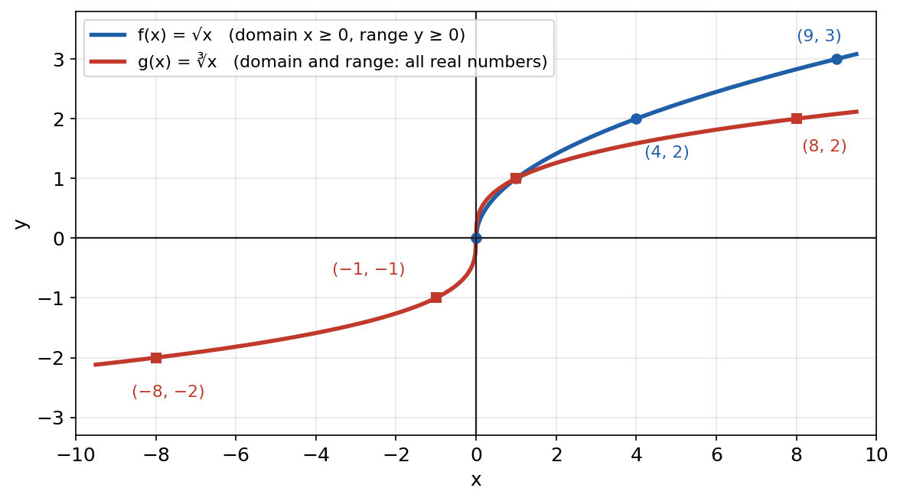
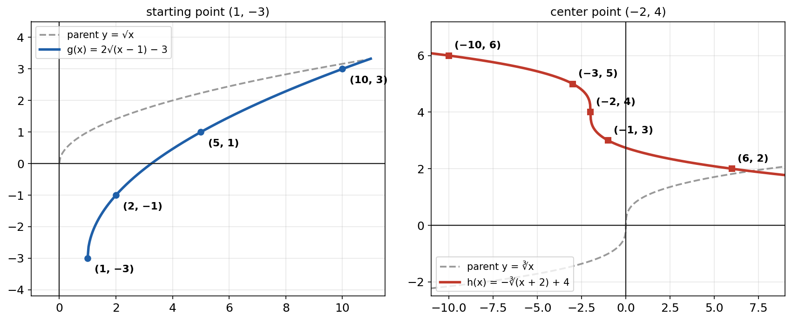

# Session M5 — Rational Exponents, Radical Expressions and Radical Graphs (Quiz Prep)

**Duration:** 45 minutes\
**Purpose:** preparation for the **quiz on Thursday, Oct 22**: rational exponents, multistep rational-exponent expressions, and an introduction to radical graphs.\
**Continues from:** Session M1 (laws of exponents, rational exponents, same-base equations) and the midterm review M3.\
**School textbook:** Big Ideas *Advanced Algebra with CalcChat and CalcView* (Larson & Boswell), chapter "Rational Exponents and Radical Functions": the lessons on nth roots and rational exponents, on properties of rational exponents and radicals, and on graphing radical functions. Georgia standard AA.FGR.4.\
**Foundation:** R.D. Sharma Class 9, *Number Systems* (rationalizing denominators) and *Exponents of Real Numbers* (rational exponents).\
**Companion:** the separate *Practice Quiz* (40 points, 30 minutes) and its answer key. Give it at the end of this session or tonight as homework.

---

## Lesson Plan

**Objectives.** By the end of this session the student should be able to:

1. Find real nth roots, and say when an even root has two, one or no real values.
2. Evaluate $a^{m/n}$ without a calculator, including negative bases and negative exponents.
3. Switch between radical form and rational-exponent form.
4. Solve equations of the form $ax^n = c$ and $x^{m/n} = c$.
5. Simplify multistep expressions with rational exponents, and write radicals in simplest form (including rationalizing a denominator).
6. Graph $y = a\sqrt{x - h} + k$ and $y = a\sqrt[3]{x - h} + k$, and state their domain and range.

| Time | Segment |
| --- | --- |
| 0–3 min | Warm-up: 3 exponent-law questions |
| 3–13 min | Part 1: nth roots and rational exponents; solving |
| 13–27 min | Part 2: properties; multistep expressions; simplest radical form |
| 27–39 min | Part 3: radical graphs and transformations |
| 39–45 min | Quick check, then hand out the practice quiz |

**Pacing note.** The quiz title says "multistep expressions", so Part 2 gets the most time. If time is short, do Worked Examples 4 and 5 in full and set the rest of Part 2's practice as homework.

---

## Warm-up (3 min)

1. $x^5 \cdot x^{-2} = x^3$ (product rule: add exponents)
2. $\dfrac{y^{4}}{y^{7}} = y^{-3} = \dfrac{1}{y^3}$ (quotient rule: subtract exponents)
3. $(2a^3)^4 = 16a^{12}$ (power of a product, then power of a power)

**Bridge to today:** every one of these rules still works when the exponents are fractions. Today's quiz questions are these same rules with fractions in them.

---

## Formula Sheet

| Idea | Rule | Example |
| --- | --- | --- |
| nth root | $\sqrt[n]{a} = a^{1/n}$ | $\sqrt[3]{8} = 8^{1/3} = 2$ |
| rational exponent | $a^{m/n} = \left(\sqrt[n]{a}\right)^m = \sqrt[n]{a^m}$ | $8^{2/3} = (\sqrt[3]{8})^2 = 4$ |
| negative exponent | $a^{-m/n} = \dfrac{1}{a^{m/n}}$ | $8^{-2/3} = \dfrac{1}{4}$ |
| product | $a^{m}a^{n} = a^{m+n}$ | $5^{1/2}\cdot 5^{3/2} = 5^2$ |
| quotient | $\dfrac{a^m}{a^n} = a^{m-n}$ | $\dfrac{7^{5/3}}{7^{2/3}} = 7$ |
| power of a power | $(a^m)^n = a^{mn}$ | $(x^{2/3})^{6} = x^4$ |
| power of a product | $(ab)^m = a^mb^m$ | $(8x^3)^{1/3} = 2x$ |
| product of radicals | $\sqrt[n]{ab} = \sqrt[n]{a}\cdot\sqrt[n]{b}$ | $\sqrt{12} = \sqrt{4}\sqrt{3} = 2\sqrt{3}$ |
| quotient of radicals | $\sqrt[n]{\dfrac{a}{b}} = \dfrac{\sqrt[n]{a}}{\sqrt[n]{b}}$ | $\sqrt[3]{\dfrac{5}{8}} = \dfrac{\sqrt[3]{5}}{2}$ |

---

## Part 1 — nth Roots and Rational Exponents (10 min)

### nth roots

> If $b^n = a$, then b is an **nth root** of a, written $\sqrt[n]{a}$. n is the **index**.

How many **real** nth roots a number has depends on whether n is odd or even:

| | $a > 0$ | $a = 0$ | $a < 0$ |
| --- | --- | --- | --- |
| **n odd** | one real root: $\sqrt[3]{8} = 2$ | 0 | one real root: $\sqrt[3]{-8} = -2$ |
| **n even** | two real roots: $\pm\sqrt[4]{16} = \pm 2$ | 0 | **no real root**: $\sqrt[4]{-16}$ is not real |

**Why:** an odd power keeps the sign ($(-2)^3 = -8$), so a negative number has an odd root. An even power is never negative ($(\pm 2)^4 = 16$), so a negative number has no real even root.

### Why $a^{1/n}$ means the nth root

The power-of-a-power rule must still hold for fractions. Raise $a^{1/n}$ to the nth power:

$$\left(a^{1/n}\right)^n = a^{\frac{1}{n}\cdot n} = a^1 = a$$

So $a^{1/n}$ is the number whose nth power is a: it is $\sqrt[n]{a}$. Then $a^{m/n} = \left(a^{1/n}\right)^m = \left(\sqrt[n]{a}\right)^m$.

**Read the fraction as an instruction:** the **denominator is the root**, the **numerator is the power** ("power over root"). Take the root first so the numbers stay small.

### Worked Example 1: evaluate without a calculator

- $64^{2/3} = \left(\sqrt[3]{64}\right)^2 = 4^2 = 16$
- $(-32)^{3/5} = \left(\sqrt[5]{-32}\right)^3 = (-2)^3 = -8$ (odd root of a negative is fine)
- $9^{-3/2} = \dfrac{1}{9^{3/2}} = \dfrac{1}{(\sqrt{9})^3} = \dfrac{1}{27}$
- $\left(\dfrac{16}{81}\right)^{3/4} = \dfrac{(\sqrt[4]{16})^3}{(\sqrt[4]{81})^3} = \dfrac{2^3}{3^3} = \dfrac{8}{27}$
- $(-64)^{1/2}$: an even root of a negative number, **not a real number**.

### Worked Example 2: rewrite between the two forms

- $\sqrt[5]{x^2} = x^{2/5}$, and $\left(\sqrt[4]{y}\right)^3 = y^{3/4}$
- $z^{3/2} = \sqrt{z^3} = (\sqrt{z})^3$, and $7^{-1/3} = \dfrac{1}{\sqrt[3]{7}}$
- A decimal exponent becomes a fraction first: $10^{0.6} = 10^{3/5} = \sqrt[5]{10^3}$

### Worked Example 3: solve with nth roots

To solve $x^n = c$, take the nth root of both sides. **With an even n, remember ±.**

- $4x^5 = 128$: $x^5 = 32$, so $x = \sqrt[5]{32} = 2$ (odd index: one answer).
- $(x - 3)^4 = 21$: $x - 3 = \pm\sqrt[4]{21}$, so $x = 3 \pm \sqrt[4]{21}$, i.e. $x \approx 5.14$ or $x \approx 0.86$.
- $x^{2/3} = 16$: raise both sides to the reciprocal power $\tfrac{3}{2}$. Since the numerator 2 is even, both signs work: $\left(x^{1/3}\right)^2 = 16$ gives $x^{1/3} = \pm 4$, so $x = \pm 64$. Check: $(-64)^{2/3} = (-4)^2 = 16$ ✓

---

## Part 2 — Properties and Multistep Expressions (14 min)

### The method for any multistep expression

1. **Powers outside parentheses first:** multiply every exponent inside by the outside exponent (power of a power), including the number's.
2. **Evaluate numbers** with rational exponents (root first, then power).
3. **Combine the same base:** add exponents when multiplying, subtract when dividing. Use a common denominator for the fractions.
4. **Finish with positive exponents** (move negative ones across the fraction bar), unless the question says otherwise.

### Worked Example 4: multistep simplification (variables positive)

**(a)** $\left(8x^6y^{-3}\right)^{2/3}$

$$= 8^{2/3}\,x^{6\cdot\frac{2}{3}}\,y^{-3\cdot\frac{2}{3}} = 4x^4y^{-2} = \frac{4x^4}{y^2}$$

**(b)** $\left(a^{1/3}b^{-1/2}\right)^6 \cdot a^{-1}b^4$

$$= a^{2}b^{-3}\cdot a^{-1}b^{4} = a^{2-1}\,b^{-3+4} = ab$$

**(c)** $\left(\dfrac{x^{3/4}}{x^{1/4}}\right)^{-2}$

$$= \left(x^{\frac{3}{4}-\frac{1}{4}}\right)^{-2} = \left(x^{1/2}\right)^{-2} = x^{-1} = \frac{1}{x}$$

**(d)** $6^{1/2}\cdot 6^{1/3}$: add with a common denominator, $\tfrac{1}{2} + \tfrac{1}{3} = \tfrac{3}{6} + \tfrac{2}{6} = \tfrac{5}{6}$, so the answer is $6^{5/6}$.

### Simplest radical form

A radical is in simplest form when:

1. the radicand has **no factor that is a perfect nth power**;
2. there is **no radical in a denominator**;
3. there is **no fraction under the radical**.

### Worked Example 5: simplify radicals

- $\sqrt{50x^3y^2} = \sqrt{25x^2y^2}\cdot\sqrt{2x} = 5xy\sqrt{2x}$ (x, y positive)
- $\sqrt[3]{-54x^4} = \sqrt[3]{-27x^3}\cdot\sqrt[3]{2x} = -3x\sqrt[3]{2x}$
- **Like radicals** (same index and radicand) add like like terms: $3\sqrt{12} - \sqrt{27} = 6\sqrt{3} - 3\sqrt{3} = 3\sqrt{3}$, and $\sqrt[3]{40} + 2\sqrt[3]{5} = 2\sqrt[3]{5} + 2\sqrt[3]{5} = 4\sqrt[3]{5}$.

### Worked Example 6: rationalize the denominator

- $\dfrac{3}{\sqrt{6}} = \dfrac{3}{\sqrt{6}}\cdot\dfrac{\sqrt{6}}{\sqrt{6}} = \dfrac{3\sqrt{6}}{6} = \dfrac{\sqrt{6}}{2}$
- $\dfrac{5}{\sqrt[3]{2}} = \dfrac{5}{\sqrt[3]{2}}\cdot\dfrac{\sqrt[3]{4}}{\sqrt[3]{4}} = \dfrac{5\sqrt[3]{4}}{\sqrt[3]{8}} = \dfrac{5\sqrt[3]{4}}{2}$ (multiply until the denominator is a perfect cube)
- $\dfrac{2}{1 + \sqrt{3}}$: multiply by the **conjugate** $1 - \sqrt{3}$, because $(a + b)(a - b) = a^2 - b^2$ removes the root:

$$\frac{2(1 - \sqrt{3})}{(1 + \sqrt{3})(1 - \sqrt{3})} = \frac{2(1 - \sqrt{3})}{1 - 3} = \frac{2(1 - \sqrt{3})}{-2} = \sqrt{3} - 1$$

---

## Part 3 — Radical Graphs (12 min)

### The two parent functions

{width=82%}

| | $f(x) = \sqrt{x}$ | $g(x) = \sqrt[3]{x}$ |
| --- | --- | --- |
| key points | (0, 0), (1, 1), (4, 2), (9, 3) | (−8, −2), (−1, −1), (0, 0), (1, 1), (8, 2) |
| domain | $x \ge 0$ (can't take an even root of a negative) | all real numbers |
| range | $y \ge 0$ | all real numbers |
| shape | starts at the origin and rises, flattening | S-shape through the origin, steepest at the center |

**Choose x-values that make the radicand a perfect square (0, 1, 4, 9) or a perfect cube (−8, −1, 0, 1, 8).** Then every point is a whole number.

### Transformations

$$y = a\sqrt{x - h} + k \qquad\qquad y = a\sqrt[3]{x - h} + k$$

| Change | Effect |
| --- | --- |
| $x - h$ inside | shift **right** h (left if it reads $x + h$) |
| $+ k$ outside | shift **up** k |
| $\lvert a\rvert > 1$ | vertical stretch; $0 < \lvert a\rvert < 1$: vertical shrink |
| $a < 0$ | reflection in the **x-axis** |
| $\sqrt{-x}$ | reflection in the **y-axis** |

The starting point of the square-root graph (and the center of the cube-root graph) moves from (0, 0) to **(h, k)**.

### Worked Example 7: graph two transformed functions

{width=100%}

**(a)** $g(x) = 2\sqrt{x - 1} - 3$

- Transformations: vertical stretch by 2, shift right 1, shift down 3. Starting point (1, −3).
- Points: choose $x - 1 = 0, 1, 4, 9$, i.e. $x = 1, 2, 5, 10$. Then $y = 2(0) - 3 = -3$, $2(1) - 3 = -1$, $2(2) - 3 = 1$, $2(3) - 3 = 3$.
- Domain $x \ge 1$; range $y \ge -3$.

**(b)** $h(x) = -\sqrt[3]{x + 2} + 4$

- Transformations: reflection in the x-axis, shift left 2, shift up 4. Center (−2, 4).
- Points: choose $x + 2 = -8, -1, 0, 1, 8$, i.e. $x = -10, -3, -2, -1, 6$. Then $y = 6, 5, 4, 3, 2$.
- Domain and range: all real numbers. The graph now falls from left to right (the reflection).

### Worked Example 8: write a rule from a description

- "Reflect $f(x) = \sqrt{x}$ in the y-axis, then shift it up 3": $g(x) = \sqrt{-x} + 3$. Domain $x \le 0$ (because $-x \ge 0$), range $y \ge 3$.
- "Stretch $f(x) = \sqrt[3]{x}$ vertically by 3, then shift it right 4 and down 2": $g(x) = 3\sqrt[3]{x - 4} - 2$.

---

## Quick Check (3 min)

1. Evaluate $27^{-2/3}$.
2. Simplify $\left(x^{1/2}y^{2}\right)^{4}\cdot x^{-1}$.
3. Give the domain and range of $y = \sqrt{x + 5} - 2$.

---

## Practice Problems

*Assume all variables are positive. The separate Practice Quiz is the main homework; these are extra practice.*

1. Evaluate: (a) $49^{3/2}$ (b) $(-125)^{1/3}$ (c) $32^{-4/5}$ (d) $\left(\tfrac{8}{27}\right)^{-2/3}$
2. Solve: (a) $x^6 = 64$ (b) $-2x^3 = 250$ (c) $(x + 1)^{3/2} = 8$
3. Simplify: (a) $\left(9x^4y^{-6}\right)^{1/2}$ (b) $\dfrac{a^{5/6}\cdot a^{1/3}}{a^{1/2}}$ (c) $\left(2x^{1/4}\right)^{4}\left(x^{-1/2}\right)^{2}$
4. Simplify: (a) $\sqrt{72} + \sqrt{18}$ (b) $\sqrt[4]{48x^5}$ (c) $\dfrac{6}{\sqrt{2}}$ (d) $\dfrac{4}{3 + \sqrt{5}}$
5. For $y = -\sqrt{x - 2} + 1$: describe the transformations, give the starting point, three more points, the domain and the range.
6. Write a rule for the graph of $f(x) = \sqrt[3]{x}$ shifted left 5 and up 2, then reflected in the x-axis. (Careful: here the reflection comes last.)

---

## Answer Key — Full Step-by-Step Solutions

**Quick check**

1. $27^{-2/3} = \dfrac{1}{(\sqrt[3]{27})^2} = \dfrac{1}{9}$.
2. $\left(x^{1/2}y^2\right)^4 = x^{2}y^{8}$; times $x^{-1}$ gives $xy^8$.
3. Need $x + 5 \ge 0$: domain $x \ge -5$. The starting point is (−5, −2), so the range is $y \ge -2$.

**1.**

- **(a)** $(\sqrt{49})^3 = 7^3 = 343$
- **(b)** $\sqrt[3]{-125} = -5$
- **(c)** $\dfrac{1}{(\sqrt[5]{32})^4} = \dfrac{1}{2^4} = \dfrac{1}{16}$
- **(d)** Flip for the negative exponent: $\left(\tfrac{27}{8}\right)^{2/3} = \dfrac{(\sqrt[3]{27})^2}{(\sqrt[3]{8})^2} = \dfrac{9}{4}$

**2.**

- **(a)** Even index: $x = \pm\sqrt[6]{64} = \pm 2$.
- **(b)** $x^3 = -125$, so $x = -5$.
- **(c)** Raise both sides to $\tfrac{2}{3}$: $x + 1 = 8^{2/3} = 4$, so $x = 3$. (The denominator 2 is an even root, so $x + 1$ must be at least 0: there is only one answer.) Check: $4^{3/2} = 8$ ✓

**3.**

- **(a)** $9^{1/2}x^{2}y^{-3} = \dfrac{3x^2}{y^3}$
- **(b)** Numerator: $\tfrac{5}{6} + \tfrac{2}{6} = \tfrac{7}{6}$. Then $\tfrac{7}{6} - \tfrac{3}{6} = \tfrac{4}{6} = \tfrac{2}{3}$: the answer is $a^{2/3}$.
- **(c)** $2^4x^{1}\cdot x^{-1} = 16x^0 = 16$

**4.**

- **(a)** $6\sqrt{2} + 3\sqrt{2} = 9\sqrt{2}$
- **(b)** $\sqrt[4]{16x^4}\cdot\sqrt[4]{3x} = 2x\sqrt[4]{3x}$
- **(c)** $\dfrac{6\sqrt{2}}{2} = 3\sqrt{2}$
- **(d)** Multiply by the conjugate: $\dfrac{4(3 - \sqrt{5})}{9 - 5} = \dfrac{4(3 - \sqrt{5})}{4} = 3 - \sqrt{5}$

**5.** Reflection in the x-axis, shift right 2, shift up 1. Starting point (2, 1). Points: $x = 3$: $-1 + 1 = 0$; $x = 6$: $-2 + 1 = -1$; $x = 11$: $-3 + 1 = -2$. Domain $x \ge 2$; range $y \le 1$.

**6.** Shift first: $\sqrt[3]{x + 5} + 2$. Then reflect the **whole** output in the x-axis: $g(x) = -\left(\sqrt[3]{x + 5} + 2\right) = -\sqrt[3]{x + 5} - 2$. (Reflecting first would give $-\sqrt[3]{x + 5} + 2$ instead; the order matters when the shift is vertical.)

---

## Most common mistakes on this quiz

1. **Root and power swapped:** in $a^{m/n}$ the denominator is the root. $8^{2/3}$ is 4, not $\sqrt{8^3}$.
2. **Making the answer negative because the exponent is negative:** $9^{-1/2} = \tfrac{1}{3}$, not $-3$.
3. **Missing ±** when solving with an even root ($x^4 = 16$ has two real answers).
4. **Calling an odd root of a negative "not real":** $\sqrt[3]{-8} = -2$ is real. Only even roots of negatives are not real.
5. **Forgetting to raise the number:** $(8x^6)^{2/3} = 4x^4$, not $8x^4$.
6. **Adding fractions without a common denominator:** $x^{1/2}\cdot x^{1/3} = x^{5/6}$, not $x^{2/5}$.
7. **Shifting the wrong way:** $\sqrt{x - 1}$ moves **right** 1.
8. **Domain of a cube-root function:** it is all real numbers, not $x \ge h$.

---

## Notes for next session

- Go over the practice quiz; redo any question he missed with a fresh number.
- After the quiz, the school chapter continues with solving radical equations (extraneous solutions), operations on functions and inverse functions. Those lead into the exponential and logarithmic lessons from his eCLASS list (Session M4 is ready for those).
