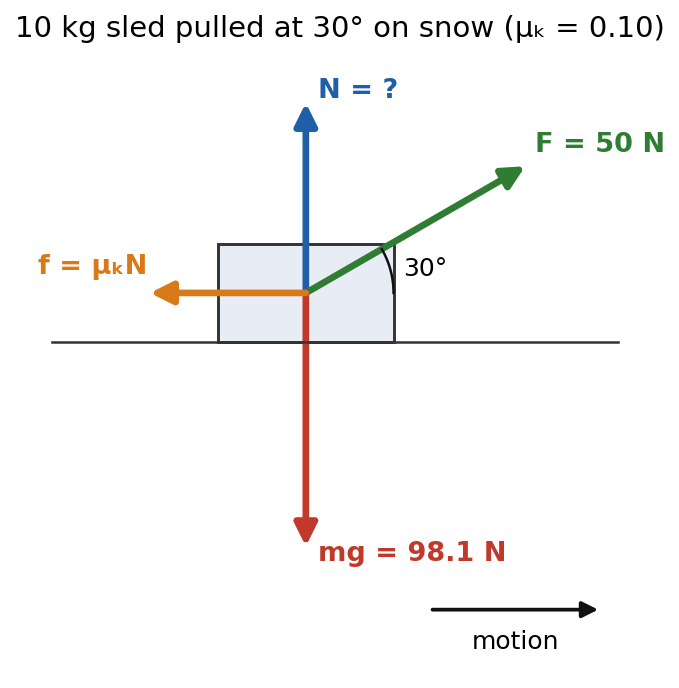
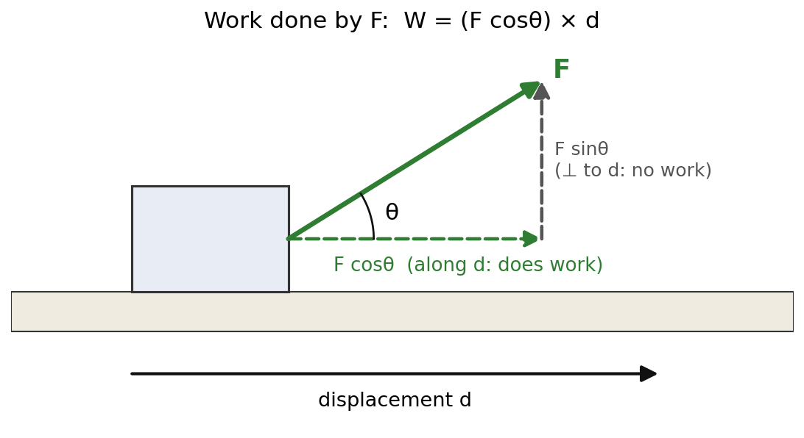
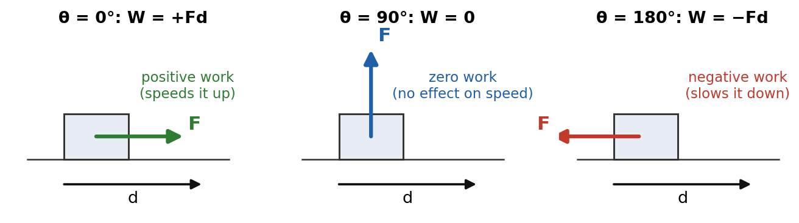
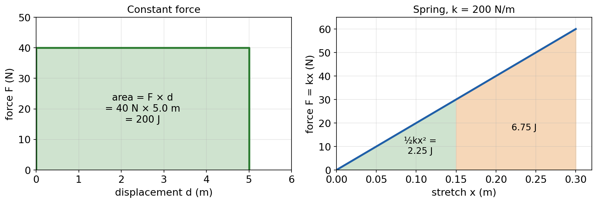

# Session 8 — Energy I: Work, Kinetic Energy and the Work–Energy Theorem

**Duration:** 45 minutes\
**Continues from:** Sessions 1–7 (vectors, kinematics, Newton's laws, friction, inclines). Midterm score 74/100, so this session opens with a 10-minute diagnostic.\
**School unit:** "Work, Energy and Power", the unit after forces.\
**Grade-9 foundation:** NCERT Class 9 *Work and Energy*: work done by a constant force, kinetic energy, power.\
**Grade-11 depth:**

- HMH *Physics* Ch 5 "Work and Energy" (the school's main text): the sections on work, energy and power.
- Glencoe *Physics: Principles and Problems* Ch 10 "Energy, Work, and Simple Machines" §10.1 Energy and Work, and Ch 11 "Energy and Its Conservation" §11.1 The Many Forms of Energy.
- Hewitt *Conceptual Physics*, chapter "Energy": work, power, kinetic energy, the work–energy theorem.

**Why now:** Unit 3 starts when school resumes. Work is built from forces, vector components and the SUVAT equations, so this unit also re-drills the midterm topics.\
**g = 9.81 m/s²** throughout, matching the school.

---

## Lesson Plan

**Objectives.** By the end of this session the student should be able to:

1. Find where his midterm marks went, using a 5-question diagnostic with one question per midterm topic.
2. State the definition of **work** done by a constant force, $W = Fd\cos\theta$, and say when work is positive, negative or zero.
3. Find the work done by each force on an object, and the **net work**.
4. Derive $KE = \tfrac{1}{2}mv^2$ and the **work–energy theorem** $W_{net} = \Delta KE$ from $F = ma$ and $v^2 = u^2 + 2as$.
5. Use the theorem to find speeds and stopping distances without finding the acceleration first.
6. Define **power** and use $P = W/t$ and $P = Fv$.

| Time | Segment |
| --- | --- |
| 0–10 min | Diagnostic: 5 midterm-style questions (vectors, 1D, projectile, FBD, third law) |
| 10–22 min | Part 1: work |
| 22–35 min | Part 2: kinetic energy and the work–energy theorem |
| 35–40 min | Part 3: power |
| 40–45 min | Exit ticket, assign homework |

**Pacing note.** Mark the diagnostic straight away and record which questions he missed (table at the end of the diagnostic). If he misses two or more, give the missed topics 10 minutes at the start of the next session before Session 9. If time runs short today, Part 3 (power) can be set as reading with Practice Q13–Q14; it comes back in Session 10.

---

## Diagnostic Warm-up (10 min)

*Work alone, calculator allowed, 2 minutes per question. Answers and the "what a mistake means" table are below.*

**D1. Vectors.** A 40 N force points at 150° measured counter-clockwise from the +x axis. Find its x- and y-components.

**D2. 1D kinematics.** A car speeds up uniformly from 6.0 m/s to 24 m/s in 4.0 s. Find its acceleration and the distance it covers.

**D3. Projectile.** A ball rolls off a 20 m high ledge at 8.0 m/s horizontally. How long does it take to land, and how far from the base of the ledge does it land?

**D4. Free-body diagram.** A 10 kg sled is pulled across level snow by a rope at 30° above the horizontal with a 50 N force. $\mu_k = 0.10$. Find the normal force, the friction force and the acceleration.

{width=60%}

**D5. Third law.** A 2000 kg truck and an 800 kg car collide head-on. (a) Which vehicle feels the larger force? (b) Which has the larger acceleration, and by what factor?

### Diagnostic answers

- **D1.** $F_x = 40\cos150° = -34.6$ N and $F_y = 40\sin150° = +20.0$ N. The x-component is negative because 150° is in quadrant II.
- **D2.** $a = \dfrac{v - u}{t} = \dfrac{24 - 6.0}{4.0} = 4.5$ m/s². Distance $s = \tfrac{1}{2}(u + v)t = \tfrac{1}{2}(6.0 + 24)(4.0) = 60$ m.
- **D3.** Vertical motion starts from rest: $20 = \tfrac{1}{2}(9.81)t^2$, so $t = \sqrt{2(20)/9.81} = 2.02$ s. Horizontal: $x = 8.0 \times 2.02 = 16.2$ m.
- **D4.** Vertical: $N + 50\sin30° - mg = 0$, so $N = 98.1 - 25.0 = 73.1$ N (**not** 98.1 N: the rope lifts part of the weight). Friction $f = \mu_k N = 0.10 \times 73.1 = 7.31$ N. Horizontal: $50\cos30° - 7.31 = 10a$, so $43.3 - 7.31 = 10a$ and $a = 3.60$ m/s².
- **D5.** (a) **Equal** forces: they are a third-law pair. (b) $a = F/m$, so the car's acceleration is $2000/800 = 2.5$ times the truck's.

| Missed | Topic | Revisit |
| --- | --- | --- |
| D1 | angles beyond 90°, signs of components | Session 3, Part 1 |
| D2 | choosing the right SUVAT equation | Session 1 |
| D3 | splitting a projectile into x and y | Session 2 |
| D4 | normal force with an angled pull | Session 6, Part 2 |
| D5 | third-law pairs and $a = F/m$ | Session 6, Part 1 |

Keep the sled from D4 in mind: Part 1 uses it again.

---

## Formula Sheet — Energy I

| Label | Equation | In words |
| --- | --- | --- |
| **W1** | $W = Fd\cos\theta$ | work by a constant force; θ is the angle between **F** and **d** |
| **W2** | $W_{net} = W_1 + W_2 + \dots = F_{net}\,d$ | net work: add the work of every force |
| **K** | $KE = \tfrac{1}{2}mv^2$ | kinetic energy, a scalar, never negative |
| **WE** | $W_{net} = KE_f - KE_i = \tfrac{1}{2}mv^2 - \tfrac{1}{2}mu^2$ | work–energy theorem |
| **SD** | $d = \dfrac{v^2}{2\mu_k g}$ | skidding distance on a level road (from WE) |
| **P1** | $P = \dfrac{W}{t}$ | power: the rate of doing work |
| **P2** | $P = Fv$ | power when a force F keeps an object at speed v (force along v) |

Units: 1 joule (J) = 1 N·m. 1 watt (W) = 1 J/s. 1 horsepower (hp) = 746 W.

Still used: $F_{net} = ma$, $W = mg$, $f_k = \mu_k N$, $v^2 = u^2 + 2as$.

---

## Part 1 — Work (12 min)

### What "work" means in physics (NCERT *Work and Energy*, Glencoe §10.1, HMH Ch 5)

In everyday language, holding a heavy bag for ten minutes is hard work. In physics it is **no work at all** on the bag, because the bag doesn't move. Physics work needs two things: a **force**, and a **displacement** with part of it along the force.

> **Definition (work by a constant force).** The work W done on an object by a constant force F is the component of the force along the displacement multiplied by the size of the displacement:
> $$W = (F\cos\theta)\,d = Fd\cos\theta$$
> where θ is the angle between the force and the displacement. Work is a **scalar**, measured in **joules**: 1 J is the work done by a 1 N force acting through 1 m.

### Where $\cos\theta$ comes from

{width=80%}

Split the force into two perpendicular components, exactly as in Session 3:

- **along** the displacement: $F\cos\theta$. This part pushes the box the way it moves.
- **perpendicular** to it: $F\sin\theta$. The box moves zero distance in this direction, so this part does nothing to move it.

Only the first part counts, so $W = (F\cos\theta) \times d$. When the force points exactly along the motion, θ = 0 and $W = Fd$, the simple "force × distance" from Class 9.

### The sign of work

{width=95%}

| Angle θ | $\cos\theta$ | Work | Effect on the object | Examples |
| --- | --- | --- | --- | --- |
| 0° | +1 | $+Fd$ | speeds it up | pushing a cart forward |
| 0° to 90° | positive | positive | speeds it up | pulling a sled with a rope at 30° |
| 90° | 0 | **zero** | no change in speed | normal force on a level road; gravity on a ball rolling on a level floor; the string's tension on a ball moving in a circle |
| 90° to 180° | negative | negative | slows it down | friction on a sliding box; brakes |
| 180° | −1 | $-Fd$ | slows it down | friction directly opposite the motion |

**Link to Session 4.** In uniform circular motion the net force points to the center and the velocity is along the tangent, so θ = 90° at every instant. The force does **no work**, which is exactly why the speed stays constant while the direction keeps changing.

### Net work

When several forces act, find the work done by **each** force with W1, then add them (work is a scalar, so ordinary addition, with signs):

$$W_{net} = W_1 + W_2 + W_3 + \dots$$

For constant forces along a straight path, this equals $F_{net}\,d$. That gives a useful check.

### Worked Example 1: the sled from D4

The sled from D4 moves 5.0 m. Find the work done by each force and the net work.

- **Pull:** $W_F = Fd\cos30° = 50 \times 5.0 \times 0.866 = +217$ J.
- **Friction:** it points backward, θ = 180°: $W_f = 7.31 \times 5.0 \times (-1) = -36.6$ J.
- **Gravity and normal force:** both vertical, θ = 90°: $W_g = W_N = 0$.
- **Net work:** $W_{net} = 216.5 - 36.6 + 0 + 0 = +180$ J.
- **Check with W2:** $F_{net} = 43.3 - 7.31 = 36.0$ N, and $F_{net}\,d = 36.0 \times 5.0 = 180$ J ✓

### Worked Example 2: lifting at constant velocity

You lift a 12 kg box 1.5 m straight up at constant velocity. Find the work done by you, by gravity, and the net work.

- Constant velocity, so your force equals the weight: $F = mg = 12 \times 9.81 = 117.7$ N, pointing up, along the motion.
- **You:** $W_{you} = 117.7 \times 1.5 = +177$ J.
- **Gravity:** it points down while the box moves up, θ = 180°: $W_g = -177$ J.
- **Net work:** $177 - 177 = 0$. The speed doesn't change, so the net work is zero. Part 2 shows this is not a coincidence.

### Work is the area under a force–displacement graph

For a constant force, the graph of F against d is a horizontal line, and $W = Fd$ is the **area of the rectangle** under it. The same idea works when the force changes: the work is still the area under the graph.

{width=95%}

**The spring.** Hooke's law says the force needed to stretch a spring by x is $F = kx$, where k is the spring constant. The graph is a straight line through the origin, so the area is a triangle:

$$W = \tfrac{1}{2} \times \text{base} \times \text{height} = \tfrac{1}{2}(x)(kx) = \tfrac{1}{2}kx^2$$

For k = 200 N/m, stretching from 0 to 0.15 m takes $\tfrac{1}{2}(200)(0.15)^2 = 2.25$ J, but the next 0.15 m takes 6.75 J, three times as much, because the spring pulls back harder the more it is stretched. This $\tfrac{1}{2}kx^2$ returns in Session 9 as **elastic potential energy**.

---

## Part 2 — Kinetic Energy and the Work–Energy Theorem (13 min)

### Derivation (Glencoe §11.1, HMH Ch 5)

Take an object of mass m. A constant net force $F_{net}$ acts along its motion, and its speed changes from u to v over a displacement d.

**Step 1: net work.** $W_{net} = F_{net}\,d$.

**Step 2: Newton's second law.** $F_{net} = ma$, so $W_{net} = m\,a\,d$.

**Step 3: kinematics (Session 1).** $v^2 = u^2 + 2ad$, so $a\,d = \dfrac{v^2 - u^2}{2}$.

**Step 4: substitute.**

$$W_{net} = m \cdot \frac{v^2 - u^2}{2} = \tfrac{1}{2}mv^2 - \tfrac{1}{2}mu^2$$

The quantity $\tfrac{1}{2}mv^2$ appears on both sides of the change, before and after. It is called the **kinetic energy**, the energy an object has because it is moving:

$$KE = \tfrac{1}{2}mv^2$$

> **Work–energy theorem.** The net work done on an object equals the change in its kinetic energy:
> $$W_{net} = \Delta KE = KE_f - KE_i$$

**What the theorem says in words:**

- Positive net work speeds an object up; negative net work slows it down; zero net work leaves its speed unchanged (Worked Example 2, and circular motion).
- KE depends on $v^2$: **doubling the speed quadruples the kinetic energy**, and so quadruples the work needed to stop it.
- KE is a scalar and never negative. Direction doesn't matter: a 2 kg ball at 3 m/s has 9 J whether it moves up, down or sideways.
- Energy is measured in the same unit as work, joules, because work is how energy is transferred.

### Worked Example 3: the sled's speed

The sled from Worked Example 1 was already moving at 1.0 m/s when the 5.0 m pull began. Find its final speed.

- $W_{net} = +180$ J (Example 1) and $KE_i = \tfrac{1}{2}(10)(1.0)^2 = 5.0$ J.
- $KE_f = KE_i + W_{net} = 5.0 + 180 = 185$ J.
- $\tfrac{1}{2}(10)v^2 = 185$, so $v^2 = 37.0$ and $v = 6.08$ m/s.
- **Check with kinematics:** $a = 3.60$ m/s² (D4), so $v^2 = 1.0^2 + 2(3.60)(5.0) = 37.0$ ✓. Same answer, but the energy method never needed a.

### Worked Example 4: stopping distance

A 1200 kg car skids to a stop with its wheels locked on a road with $\mu_k = 0.70$. Find the skidding distance from (a) 15 m/s, (b) 30 m/s.

- Only friction does work horizontally: $f = \mu_k mg$, acting backward, so $W_{net} = -\mu_k mg\,d$.
- Final KE is zero: $-\mu_k mg\,d = 0 - \tfrac{1}{2}mv^2$.
- The mass cancels: $d = \dfrac{v^2}{2\mu_k g}$ (formula SD).
- **(a)** $d = \dfrac{15^2}{2(0.70)(9.81)} = \dfrac{225}{13.73} = 16.4$ m.
- **(b)** $d = \dfrac{30^2}{13.73} = 65.5$ m.

**Doubling the speed makes the skid four times as long.** This is why speed limits drop near schools.

### Worked Example 5: the incline from Session 6, by energy

A 5.0 kg block slides 2.0 m from rest down a 30° incline with $\mu_k = 0.20$ (Session 6, Worked Example 4). Find its speed at the bottom.

- Gravity's component along the slope does the positive work: $W_g = (mg\sin30°)\,d = 24.5 \times 2.0 = +49.1$ J.
- Friction: $f = \mu_k mg\cos30° = 0.20 \times 42.5 = 8.50$ N, opposite the motion: $W_f = -8.50 \times 2.0 = -17.0$ J.
- The normal force is perpendicular to the slope: $W_N = 0$.
- $W_{net} = 49.1 - 17.0 = 32.1$ J $= \tfrac{1}{2}(5.0)v^2$, so $v^2 = 12.8$ and $v = 3.58$ m/s.
- **Check:** Session 6 found a = 3.21 m/s², and $v^2 = 2(3.21)(2.0) = 12.8$ ✓

---

## Part 3 — Power (5 min)

### Definition (NCERT *Work and Energy*, Glencoe §10.1, HMH Ch 5)

Two students of the same mass climb the same stairs. They do the same work against gravity, but the one who runs up is more **powerful**.

> **Power** is the rate at which work is done (the rate at which energy is transferred):
> $$P = \frac{W}{t}$$
> Unit: the **watt**, 1 W = 1 J/s. Large units: 1 kW = 1000 W; 1 horsepower = 746 W.

### Derivation: $P = Fv$

If a constant force F acts along the motion of an object moving at constant speed v:

$$P = \frac{W}{t} = \frac{Fd}{t} = F\cdot\frac{d}{t} = Fv$$

This is how engines are rated: at a steady speed, the engine's force balances the drag, and the power needed is drag × speed.

### Worked Example 6

**(a)** A 55 kg student climbs stairs that rise 3.0 m in 4.0 s. Find her power.

- Work against gravity: $W = mgh = 55 \times 9.81 \times 3.0 = 1620$ J.
- $P = W/t = 1620/4.0 = 405$ W, about 0.54 hp.

**(b)** An elevator motor lifts an 800 kg car at a constant 2.0 m/s. Find the power output.

- Constant velocity, so the cable force is $F = mg = 800 \times 9.81 = 7850$ N.
- $P = Fv = 7850 \times 2.0 = 15\,700$ W $= 15.7$ kW.

---

## Exit Ticket (3 min)

1. A 2.0 kg cart speeds up from 3.0 m/s to 5.0 m/s. How much net work was done on it?
2. You push a 20 kg box from rest with a horizontal 80 N force for 4.0 m across a floor with $\mu_k = 0.25$. Find the net work and the box's final speed.
3. A car drives at constant speed on a level road. Does the normal force do any work on it? Why or why not?

---

## Practice Problems

*Use g = 9.81 m/s². Do Q5 and Q10 in class if time allows; the rest are homework.*

**Tier 1 — Work**

1. **Straight push:** A 15 N horizontal force pushes a box 3.0 m across a floor. How much work does the force do?
2. **Angled pull:** You pull a suitcase 12 m along an airport floor with a 25 N force on the handle at 40° above the horizontal. How much work do you do on the suitcase?
3. **Sign of work:** Say whether the work is positive, negative or zero, and why. (a) Gravity on a ball while it rises after being thrown up. (b) Friction on a book sliding across a table. (c) The normal force on a car on a level road. (d) The tension in a string that whirls a ball in a horizontal circle. (e) Your hand lifting a backpack off the floor.
4. **The weightlifter:** A weightlifter lifts a 100 kg barbell 2.0 m from the floor and then holds it still overhead for 3.0 s. Find the work he does on the barbell (a) during the lift at constant speed, (b) while holding it.

**Tier 2 — Several forces, kinetic energy**

5. **Crate on a rope:** A 40 kg crate is pulled 8.0 m across a floor by a rope at 25° above the horizontal with a tension of 150 N. $\mu_k = 0.30$. Find (a) the normal force, (b) the friction force, (c) the work done by each of the four forces, (d) the net work.
6. **Kinetic energy:** Find the KE of (a) a 0.145 kg baseball at 40 m/s, (b) a 1500 kg car at 25 m/s. (c) By what factor does the car's KE change if its speed doubles?

**Tier 3 — The work–energy theorem**

7. **Speeding up:** How much net work is needed to speed a 1200 kg car from 10 m/s to 20 m/s? Compare it with the work needed to go from 0 to 10 m/s.
8. **Hockey puck:** A 0.50 kg puck leaves a stick at 12 m/s and slides on ice with $\mu_k = 0.10$. Use the work–energy theorem to find how far it slides.
9. **Crate speed:** The crate in Q5 starts from rest. Find its speed after the 8.0 m pull.
10. **Ski slope:** A 60 kg skier starts from rest and slides 50 m down a 25° slope with $\mu_k = 0.10$. Use work and energy to find her speed at the bottom. Compare with the frictionless answer from Session 6 (20.4 m/s).
11. **Bullet:** A 10 g bullet moving at 400 m/s stops after going 5.0 cm into a wooden block. Find the average force the wood exerts on it.
12. **Spring:** A spring has k = 200 N/m. Find the work needed to stretch it (a) from 0 to 0.15 m, (b) from 0.15 m to 0.30 m. (c) Explain why (b) is three times (a), using the F–x graph.

**Tier 4 — Power and challenge**

13. **Stair race:** A 70 kg student runs up a staircase that rises 4.5 m in 5.0 s. Find his power in watts and in horsepower.
14. **Cruising car:** A car's engine delivers 30 kW to keep it at a constant 25 m/s. Find the total resistive force (drag plus rolling friction) on the car.
15. **Skid marks (challenge):** A car leaves skid marks 16 m long when stopping from 15 m/s. (a) Find $\mu_k$. (b) On the same road, how long would the skid marks be from 30 m/s? Answer (b) without using your answer to (a), and explain your reasoning.

---

## Answer Key — Full Step-by-Step Solutions

**Exit ticket**

1. $W_{net} = \Delta KE = \tfrac{1}{2}(2.0)(5.0^2 - 3.0^2) = 1.0 \times 16$ = **16 J**. (Not $\tfrac{1}{2}(2.0)(5.0 - 3.0)^2 = 4$ J: square the speeds first, then subtract.)
2. $N = mg = 196.2$ N, $f = 0.25 \times 196.2 = 49.1$ N. $W_{net} = (80 - 49.1) \times 4.0$ = **124 J**. $\tfrac{1}{2}(20)v^2 = 124$, so $v^2 = 12.4$ and $v$ = **3.52 m/s**.
3. **No.** The normal force is vertical and the displacement is horizontal, so θ = 90° and $W = Fd\cos90° = 0$.

**1. Straight push**

- θ = 0°: $W = Fd = 15 \times 3.0 = 45$ J.

**Answer: 45 J.**

**2. Angled pull**

- $W = Fd\cos\theta = 25 \times 12 \times \cos40° = 25 \times 12 \times 0.766 = 230$ J.

**Answer: 230 J** (the vertical part of the pull does no work).

**3. Sign of work**

- **(a) Negative.** Gravity points down, the ball moves up: θ = 180°. This is why the ball slows down.
- **(b) Negative.** Friction points opposite to the sliding: θ = 180°.
- **(c) Zero.** The normal force is perpendicular to the road: θ = 90°.
- **(d) Zero.** The tension points to the center, the velocity is along the tangent: θ = 90° at every instant, so the speed stays constant.
- **(e) Positive.** Your force is upward and the backpack moves upward: θ = 0°.

**4. The weightlifter**

- **(a)** Constant speed, so his force equals the weight: $F = 100 \times 9.81 = 981$ N. $W = 981 \times 2.0 = 1960$ J.
- **(b)** The barbell doesn't move, d = 0, so **W = 0**. His muscles use energy internally (they are constantly twitching), but no work is done on the barbell.

**Answer: 1960 J; 0 J.**

**5. Crate on a rope**

- **(a)** Vertical: $N + 150\sin25° - mg = 0$. $N = 40 \times 9.81 - 150 \times 0.423 = 392.4 - 63.4 = 329$ N.
- **(b)** $f = \mu_k N = 0.30 \times 329 = 98.7$ N.
- **(c)** Tension: $W_T = 150 \times 8.0 \times \cos25° = 150 \times 8.0 \times 0.906 = +1088$ J. Friction: $W_f = -98.7 \times 8.0 = -790$ J. Gravity and normal force: **0** each (vertical forces, horizontal motion).
- **(d)** $W_{net} = 1088 - 790 = +298$ J. Check: $F_{net} = 150\cos25° - 98.7 = 135.9 - 98.7 = 37.2$ N, and $37.2 \times 8.0 = 298$ J ✓

**Answer: 329 N; 98.7 N; +1088 J, −790 J, 0, 0; +298 J.**

**6. Kinetic energy**

- **(a)** $KE = \tfrac{1}{2}(0.145)(40)^2 = \tfrac{1}{2}(0.145)(1600) = 116$ J.
- **(b)** $KE = \tfrac{1}{2}(1500)(25)^2 = \tfrac{1}{2}(1500)(625) = 4.69 \times 10^5$ J.
- **(c)** $KE \propto v^2$, so doubling v multiplies KE by $2^2$ = **4**.

**7. Speeding up**

- $W_{net} = \tfrac{1}{2}(1200)(20^2 - 10^2) = 600 \times 300 = 1.80 \times 10^5$ J.
- From 0 to 10 m/s: $\tfrac{1}{2}(1200)(10^2) = 6.0 \times 10^4$ J.

**Answer: 1.80 × 10⁵ J, which is 3 times the work for 0 → 10 m/s,** even though the speed gain is the same 10 m/s. Each extra m/s costs more at high speed.

**8. Hockey puck**

- Friction is the only horizontal force: $W_{net} = -\mu_k mg\,d$, and the puck ends at rest.
- $-\mu_k mg\,d = 0 - \tfrac{1}{2}mv^2$, so $d = \dfrac{v^2}{2\mu_k g} = \dfrac{144}{2(0.10)(9.81)} = \dfrac{144}{1.962} = 73.4$ m.

**Answer: 73.4 m** (the mass cancels).

**9. Crate speed**

- $W_{net} = 298$ J (Q5) $= \tfrac{1}{2}(40)v^2 - 0$.
- $v^2 = 2 \times 298/40 = 14.9$, so $v = 3.86$ m/s.

**Answer: 3.86 m/s.**

**10. Ski slope**

- $mg = 60 \times 9.81 = 588.6$ N.
- Gravity along the slope: $mg\sin25° = 588.6 \times 0.423 = 248.8$ N. $W_g = 248.8 \times 50 = +12\,440$ J.
- $N = mg\cos25° = 588.6 \times 0.906 = 533.5$ N, so $f = 0.10 \times 533.5 = 53.3$ N. $W_f = -53.3 \times 50 = -2670$ J.
- $W_N = 0$ (perpendicular to the slope).
- $W_{net} = 12\,440 - 2670 = 9770$ J $= \tfrac{1}{2}(60)v^2$, so $v^2 = 325.7$ and $v = 18.0$ m/s.

**Answer: 18.0 m/s**, compared with 20.4 m/s without friction. Friction took 2670 J of the 12 440 J that gravity supplied.

**11. Bullet**

- $KE_i = \tfrac{1}{2}(0.010)(400)^2 = 800$ J, and the bullet stops, so the wood does −800 J of work.
- $-F \times 0.050 = -800$, so $F = 800/0.050 = 16\,000$ N.

**Answer: 1.6 × 10⁴ N.** (Convert 10 g → 0.010 kg and 5.0 cm → 0.050 m first.)

**12. Spring**

- **(a)** $W = \tfrac{1}{2}kx^2 = \tfrac{1}{2}(200)(0.15)^2 = 2.25$ J.
- **(b)** $W = \tfrac{1}{2}(200)(0.30)^2 - \tfrac{1}{2}(200)(0.15)^2 = 9.00 - 2.25 = 6.75$ J.
- **(c)** The work is the area under the F–x line. The second strip (0.15 → 0.30 m) is a trapezoid with heights 30 N and 60 N, area $\tfrac{1}{2}(30 + 60)(0.15) = 6.75$ J. The force is larger over that stretch, so the area is 3 times the first triangle.

**13. Stair race**

- $W = mgh = 70 \times 9.81 \times 4.5 = 3090$ J.
- $P = W/t = 3090/5.0 = 618$ W, and $618/746 = 0.83$ hp.

**Answer: 618 W ≈ 0.83 hp.**

**14. Cruising car**

- Constant speed, so the engine's driving force equals the total resistive force.
- $P = Fv$, so $F = P/v = 30\,000/25 = 1200$ N.

**Answer: 1200 N.**

**15. Skid marks**

- **(a)** From SD: $\mu_k = \dfrac{v^2}{2gd} = \dfrac{15^2}{2(9.81)(16)} = \dfrac{225}{313.9} = 0.72$.
- **(b)** On the same road, $d = \dfrac{v^2}{2\mu_k g}$ with $\mu_k$ and g unchanged, so $d \propto v^2$. Doubling v from 15 to 30 m/s multiplies d by 4: $d = 4 \times 16 = 64$ m.

**Answer: 0.72; 64 m.**

---

## Most common mistakes

1. **Using the whole force instead of the component along the motion.** For an angled pull, $W = Fd\cos\theta$, not Fd.
2. **Forgetting that friction does negative work**, or giving friction's work a positive sign and then adding it.
3. **Using N = mg when a rope pulls at an angle.** The rope's vertical component changes N, and so friction (D4, Q5). This was a midterm-type error.
4. **Squaring the change in speed instead of the speeds:** $\Delta KE = \tfrac{1}{2}m(v^2 - u^2)$, never $\tfrac{1}{2}m(v - u)^2$ (Exit ticket Q1).
5. **Mixing up work by one force and net work.** Only the **net** work equals ΔKE.
6. **Forgetting unit conversions:** grams to kilograms, centimeters to meters, kW to W.
7. **Saying "holding something up is work."** No displacement, no work done on the object.

---

## Notes for next session

- **Record the diagnostic:** which of D1–D5 were wrong, and the method error behind each. Spend the first 10 minutes of Session 9 on any topic he missed.
- **Session 9 — Energy II:** gravitational potential energy (derive $PE = mgh$ from the work done against gravity), elastic potential energy $\tfrac{1}{2}kx^2$ (from today's F–x area), conservation of mechanical energy, roller coasters and pendulums, and energy lost to friction.
- **Session 10 — Energy III:** power and efficiency, simple machines (Glencoe §10.2), and a Unit 3 practice quiz.
- **Then Unit 4:** momentum, impulse and collisions (HMH Ch 6, Glencoe Ch 9).
