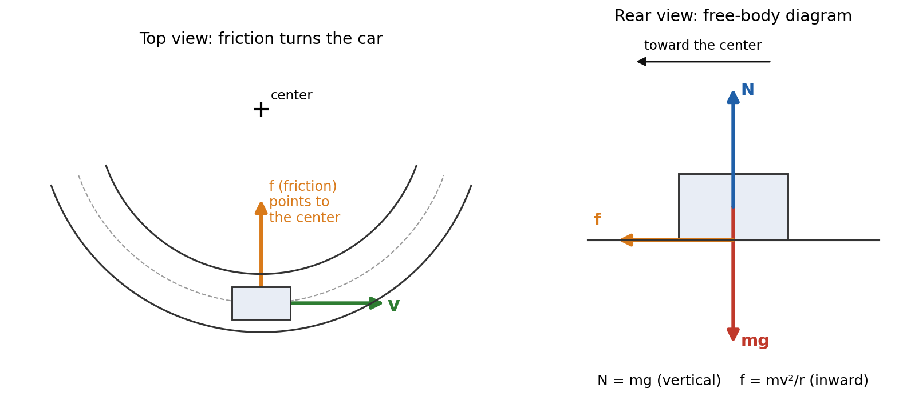
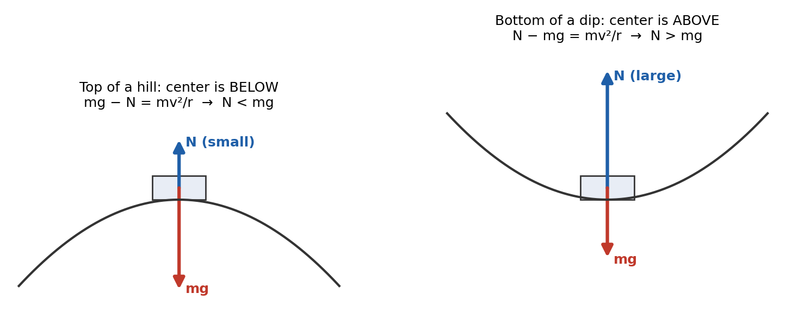
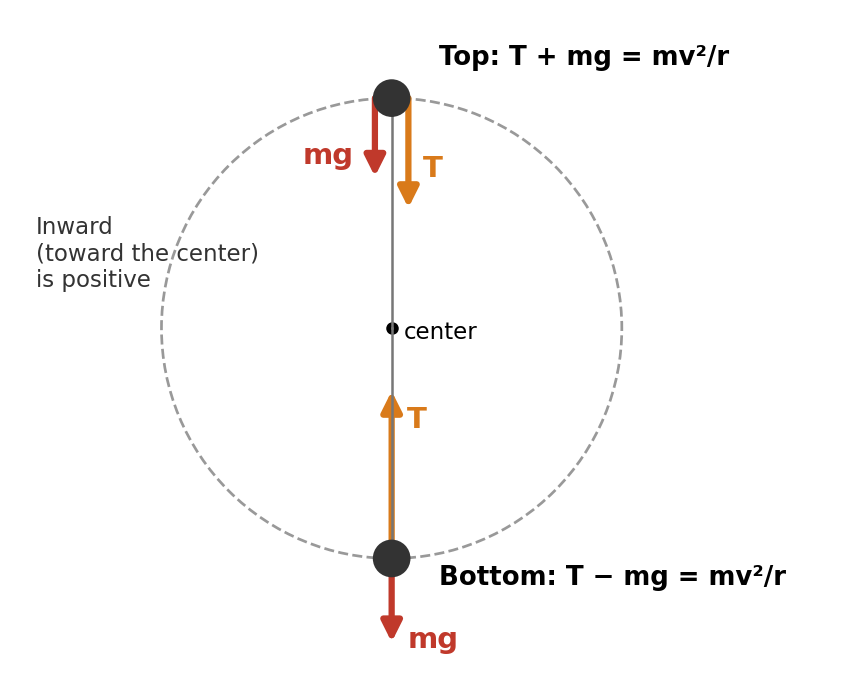
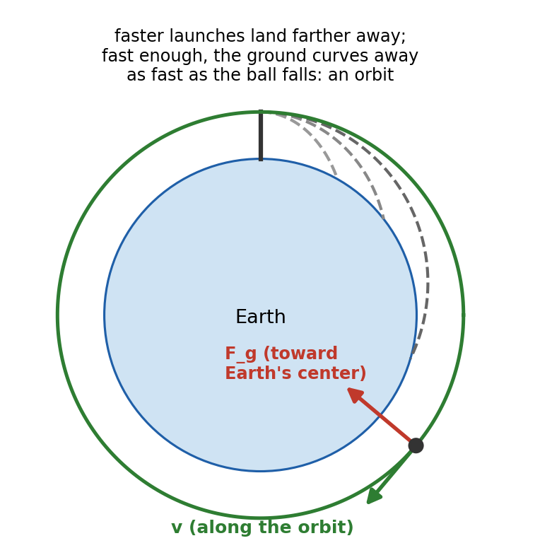

# Session 9 — Forces III: Circular Motion and Universal Gravitation

**Duration:** 45 minutes\
**Continues from:** Session 4 (the motion of uniform circular motion: $a_c = v^2/r$, $v = 2\pi r/T$), Sessions 5–6 (Newton's laws, free-body diagrams, friction).\
**School unit:** Unit 2 in the teacher's list: universal gravitation, circular motion, Hooke's law, more on Newton's laws, then a quiz. This session covers the first two; Session 10 covers Hooke's law and the Newton's-laws additions; Session 11 is quiz preparation.\
**Grade-9 foundation:** NCERT Class 9 *Gravitation* (the universal law of gravitation, free fall, g, mass and weight) and the uniform circular motion section of *Motion*.\
**Grade-11 depth:**

- HMH *Physics* Ch 7 "Circular Motion and Gravitation" (the school's main text): circular motion, Newton's law of universal gravitation, motion in space.
- Glencoe *Physics: Principles and Problems* Ch 6 §6.2 Circular Motion; Ch 7 §7.1 Planetary Motion and Gravitation and §7.2 Using the Law of Universal Gravitation.
- Hewitt *Conceptual Physics*, chapters "Gravity" and "Satellite Motion".

**Why now:** this is the topic his teacher is starting. It also re-drills free-body diagrams and $F_{net} = ma$, the skills behind the 74 on the midterm.\
**g = 9.81 m/s²** throughout, matching the school. **Constants:** $G = 6.67 \times 10^{-11}$ N·m²/kg², Earth's mass $M_E = 5.97 \times 10^{24}$ kg, Earth's radius $R_E = 6.38 \times 10^6$ m.

---

## Lesson Plan

**Objectives.** By the end of this session the student should be able to:

1. Explain why an object moving in a circle at constant speed is accelerating, and that the **centripetal force is the net force toward the center**, not a new kind of force.
2. Solve circular-motion problems with the 4-step method: free-body diagram, inward is positive, $\sum F_{in} = \dfrac{mv^2}{r}$, solve.
3. Handle the standard cases: a car on a flat curve, a hill and a dip, a ball on a string in a vertical circle.
4. State **Newton's law of universal gravitation** and use the inverse-square relationship.
5. Derive $g = \dfrac{GM}{R^2}$ and the orbital speed $v = \sqrt{\dfrac{GM}{r}}$, and use Kepler's third law.

| Time | Segment |
| --- | --- |
| 0–5 min | Warm-up: 2 questions from Session 4 and the midterm |
| 5–20 min | Part 1: centripetal force and the 4-step method |
| 20–32 min | Part 2: Newton's law of universal gravitation, g |
| 32–40 min | Part 3: satellites, orbits and Kepler's laws |
| 40–45 min | Exit ticket, assign homework |

**Pacing note.** Part 1 is the most tested part. If time is short, do Worked Examples 1–3 fully, read the banked curve as a Gifted extension, and set Part 3's geostationary example as homework (Q14).

---

## Warm-up (5 min)

1. *A 1.2 kg ball on a 0.80 m string moves in a horizontal circle on a frictionless table at 4.0 m/s. Find its acceleration.* → $a_c = \dfrac{v^2}{r} = \dfrac{4.0^2}{0.80} = 20$ m/s², pointing to the center (Session 4).
2. *What does Newton's second law say the net force on it must be?* → $F_{net} = ma = 1.2 \times 20 = 24$ N, toward the center. Something must supply this 24 N: here it is the tension in the string.

**Bridge to today:** Session 4 found the acceleration of circular motion. Today we ask which **force** causes it, and then meet the force that keeps the Moon and satellites in their circles: gravity.

---

## Formula Sheet — Forces III

| Label | Equation | In words |
| --- | --- | --- |
| **C1** | $a_c = \dfrac{v^2}{r} = \dfrac{4\pi^2 r}{T^2}$ | centripetal acceleration, toward the center |
| **C2** | $\sum F_{in} = \dfrac{mv^2}{r}$ | Newton's second law along the radius (inward positive) |
| **C3** | $v_{max} = \sqrt{\mu_s g r}$ | fastest speed around a flat curve |
| **C4** | $v_{min} = \sqrt{gr}$ | slowest speed at the top of a vertical loop; fastest over a hilltop without leaving the road |
| **G1** | $F_g = \dfrac{Gm_1m_2}{r^2}$ | Newton's law of universal gravitation |
| **G2** | $g = \dfrac{GM}{r^2}$ | gravitational field strength at distance r from a planet's center |
| **O1** | $v = \sqrt{\dfrac{GM}{r}}$ | speed of a circular orbit of radius r |
| **O2** | $T^2 = \dfrac{4\pi^2}{GM}\,r^3$ | period of an orbit (Kepler's third law) |

**r is always measured from the center:** for a satellite, $r = R_E + \text{altitude}$.

---

## Part 1 — Centripetal Force (15 min)

### Why circular motion needs a force (Glencoe §6.2, HMH Ch 7)

Velocity is a vector. An object moving in a circle at constant speed keeps changing **direction**, so its velocity changes, so it **accelerates** (Session 4). Newton's first law says that without a net force it would move in a straight line. So a net force must act, and Session 4 showed the acceleration points to the center:

$$a_c = \frac{v^2}{r}$$

*Where this came from (Session 4):* in a short time the velocity turns through the same small angle as the radius. The two triangles formed (radius–radius–chord and $v$–$v$–$\Delta v$) are similar, so $\dfrac{\Delta v}{v} = \dfrac{\Delta s}{r}$. Divide by $\Delta t$ and use $\Delta s/\Delta t = v$: $a = \dfrac{\Delta v}{\Delta t} = \dfrac{v^2}{r}$.

Apply Newton's second law along the radius:

$$\sum F_{in} = ma_c = \frac{mv^2}{r}$$

> **Centripetal force** is the name for the **net force toward the center** that keeps an object moving in a circle. It is **not a new kind of force**. It is always supplied by real forces: tension, friction, the normal force, gravity, or a combination. **Never draw a separate "centripetal force" arrow on a free-body diagram.**

| Situation | What supplies the centripetal force |
| --- | --- |
| ball whirled on a string | tension |
| car turning on a flat road | static friction between the tires and the road |
| Moon orbiting Earth | gravity |
| clothes in a spinning washer drum | the normal force from the drum wall |
| a car at the top of a hill | gravity minus the normal force |

### The 4-step method

1. **Draw the free-body diagram** with only real forces.
2. **Choose inward (toward the center) as positive.**
3. **Write $\sum F_{in} = \dfrac{mv^2}{r}$:** inward forces positive, outward forces negative. Use $\sum F = 0$ for any direction perpendicular to the circle's plane.
4. **Solve.**

### Worked Example 1: a car on a flat curve

{width=95%}

A 1200 kg car rounds a flat curve of radius 50 m. The coefficient of static friction is 0.80. (a) What friction force is needed at 15 m/s? (b) What is the fastest the car can go without skidding?

- Vertical: $N - mg = 0$, so $N = mg$.
- Inward: friction is the only horizontal force, so $f = \dfrac{mv^2}{r}$.
- **(a)** $f = \dfrac{1200 \times 15^2}{50} = 5400$ N.
- **(b)** Friction can be at most $\mu_s N = \mu_s mg$. Set $\mu_s mg = \dfrac{mv^2}{r}$; the mass cancels: $v_{max} = \sqrt{\mu_s g r} = \sqrt{0.80 \times 9.81 \times 50} = 19.8$ m/s (about 44 mph).

**Static, not kinetic, friction:** the tires roll, so the contact patch doesn't slide sideways. On ice $\mu_s$ is small, $v_{max}$ falls, and the car slides off along a tangent: the First Law in action.

### Worked Example 2: a hill and a dip

{width=90%}

A 1000 kg car travels at 15 m/s over the top of a hill and through a dip, each with radius 40 m. Find the normal force (a) at the top of the hill, (b) at the bottom of the dip. (c) How fast can it go over the hill before its tires leave the road?

- **(a)** The center is **below** the car, so down is inward: $mg - N = \dfrac{mv^2}{r}$. $N = 1000(9.81) - \dfrac{1000 \times 225}{40} = 9810 - 5625 = 4185$ N. The road pushes up with less than the weight: passengers feel lighter.
- **(b)** The center is **above**, so up is inward: $N - mg = \dfrac{mv^2}{r}$. $N = 9810 + 5625 = 15\,435$ N. Passengers feel heavier.
- **(c)** The tires leave the road when N reaches 0: $mg = \dfrac{mv^2}{r}$, so $v = \sqrt{gr} = \sqrt{9.81 \times 40} = 19.8$ m/s.

**Connection to apparent weight (Session 5):** the scale reading (the normal force) changes with the acceleration, exactly as in the elevator.

### Worked Example 3: a ball on a string in a vertical circle

{width=62%}

A 0.50 kg ball swings in a vertical circle on a 0.80 m string. Find the tension (a) at the bottom when it moves at 5.0 m/s, (b) at the top when it moves at 3.5 m/s. (c) What is the slowest it can go at the top and still keep the string tight?

- $mg = 0.50 \times 9.81 = 4.91$ N.
- **(a) Bottom:** T points up (inward), mg down (outward): $T - mg = \dfrac{mv^2}{r}$. $T = 4.91 + \dfrac{0.50 \times 25}{0.80} = 4.91 + 15.6 = 20.5$ N.
- **(b) Top:** both T and mg point down, which is now inward: $T + mg = \dfrac{mv^2}{r}$. $T = \dfrac{0.50 \times 12.25}{0.80} - 4.91 = 7.66 - 4.91 = 2.75$ N.
- **(c)** The slowest speed is when T just reaches 0, so gravity alone supplies the centripetal force: $mg = \dfrac{mv^2}{r}$, so $v_{min} = \sqrt{gr} = \sqrt{9.81 \times 0.80} = 2.80$ m/s.

The tension is largest at the bottom (it must hold the ball up **and** turn it) and smallest at the top (gravity helps). Strings break at the bottom.

### "Centrifugal force" is not a real force

In a car turning left you feel pushed to the right, against the door. No force pushes you outward. Your body has **inertia** and tries to keep going straight (First Law); the car turns under you, and the door pushes you **inward** to make you turn too. From outside, the only horizontal force on you points to the center.

### Gifted extension: the banked curve

On a curve banked at angle θ with no friction, the normal force tilts toward the center. Its horizontal part $N\sin\theta$ supplies the centripetal force and its vertical part $N\cos\theta$ balances the weight:

$$N\sin\theta = \frac{mv^2}{r}, \qquad N\cos\theta = mg \quad\Rightarrow\quad \tan\theta = \frac{v^2}{rg}$$

For 20 m/s on an 80 m curve: $\tan\theta = \dfrac{400}{80 \times 9.81} = 0.510$, so $\theta = 27.0°$. At this speed the car needs no friction at all.

---

## Part 2 — Newton's Law of Universal Gravitation (12 min)

### The law (NCERT *Gravitation*, Glencoe §7.1, HMH Ch 7)

> **Newton's law of universal gravitation.** Every particle in the universe attracts every other particle with a force that is directly proportional to the product of their masses and inversely proportional to the square of the distance between their centers:
> $$F_g = \frac{Gm_1m_2}{r^2}, \qquad G = 6.67 \times 10^{-11}\ \text{N·m}^2/\text{kg}^2$$
> The force acts along the line joining the centers. The two objects pull on each other with forces of equal size and opposite direction: a third-law pair.

- **Universal:** the same law pulls an apple to the ground and holds the Moon in orbit. Newton's insight was that these are one force.
- **G is tiny,** so gravity between everyday objects is undetectable. Henry Cavendish first measured G in 1798 with a torsion balance.
- **Inverse-square:** double the distance and the force falls to $\left(\tfrac{1}{2}\right)^2 = \tfrac{1}{4}$; triple it and the force falls to $\tfrac{1}{9}$; halve it and the force is 4 times larger.

### Worked Example 4: two students, and Earth and the Moon

**(a)** Two 70 kg students stand 1.0 m apart:

$$F = \frac{(6.67 \times 10^{-11})(70)(70)}{1.0^2} = 3.27 \times 10^{-7}\ \text{N}$$

That is about the weight of a grain of sand. You never notice it.

**(b)** Earth ($5.97 \times 10^{24}$ kg) and the Moon ($7.35 \times 10^{22}$ kg), $3.84 \times 10^8$ m apart:

$$F = \frac{(6.67 \times 10^{-11})(5.97 \times 10^{24})(7.35 \times 10^{22})}{(3.84 \times 10^8)^2} = 1.98 \times 10^{20}\ \text{N}$$

Huge masses make gravity the force that dominates astronomy.

### Derivation: where g comes from

An object of mass m at Earth's surface has weight mg. That weight **is** the gravitational force from Earth, with $r = R_E$:

$$mg = \frac{GM_Em}{R_E^2} \quad\Rightarrow\quad g = \frac{GM_E}{R_E^2} = \frac{(6.67 \times 10^{-11})(5.97 \times 10^{24})}{(6.38 \times 10^6)^2} = 9.78\ \text{m/s}^2$$

The object's own mass cancels, which is **why all objects fall with the same acceleration** (Session 5). The measured value varies slightly with location (Earth spins and is not a perfect sphere); we use the school's 9.81 m/s².

**Away from the surface,** replace $R_E$ by the distance from Earth's center, $r = R_E + h$:

- At the International Space Station's height (400 km): $r = 6.78 \times 10^6$ m, so $g = \dfrac{3.98 \times 10^{14}}{(6.78 \times 10^6)^2} = 8.66$ m/s². A 70 kg astronaut there still weighs $70 \times 8.66 = 606$ N. **Gravity is far from zero in orbit.**
- On Mars ($M = 6.42 \times 10^{23}$ kg, $R = 3.40 \times 10^6$ m): $g = 3.70$ m/s².

---

## Part 3 — Satellites, Orbits and Kepler's Laws (8 min)

### Why a satellite doesn't fall down

{width=60%}

A satellite **is** falling, all the time. It also moves sideways so fast that the Earth's surface curves away beneath it as fast as it falls. It keeps falling around the Earth instead of into it. Astronauts feel weightless because they and the station fall together (like the free-falling elevator), not because gravity is missing.

### Derivation: orbital speed and period

For a circular orbit, gravity is the only force and it supplies the centripetal force:

$$\frac{GMm}{r^2} = \frac{mv^2}{r} \quad\Rightarrow\quad v = \sqrt{\frac{GM}{r}}$$

The satellite's mass cancels: a feather and a space station at the same height orbit at the same speed. One orbit covers $2\pi r$, so the period is

$$T = \frac{2\pi r}{v} = 2\pi\sqrt{\frac{r^3}{GM}} \quad\Rightarrow\quad T^2 = \frac{4\pi^2}{GM}\,r^3$$

### Kepler's three laws (Glencoe §7.1)

1. **Law of orbits:** each planet moves in an ellipse with the Sun at one focus.
2. **Law of areas:** a line from the Sun to a planet sweeps out equal areas in equal times, so a planet moves fastest when it is closest to the Sun.
3. **Law of periods:** the square of the period is proportional to the cube of the average orbit radius, $T^2 \propto r^3$. For circular orbits, the equation above gives the constant: $\dfrac{4\pi^2}{GM}$.

Kepler found these from data around 1609–1619; Newton's law of gravitation explained them 70 years later.

### Worked Example 5: the International Space Station

The ISS orbits 400 km above Earth's surface. Find its speed and period.

- $r = 6.38 \times 10^6 + 0.40 \times 10^6 = 6.78 \times 10^6$ m, and $GM_E = 3.98 \times 10^{14}$ m³/s².
- $v = \sqrt{\dfrac{3.98 \times 10^{14}}{6.78 \times 10^6}} = 7660$ m/s (about 17,000 mph).
- $T = \dfrac{2\pi r}{v} = \dfrac{2\pi(6.78 \times 10^6)}{7660} = 5560$ s, about **92.6 minutes**: astronauts see about 16 sunrises a day.

---

## Exit Ticket (3 min)

1. A 0.20 kg rock on a 0.50 m string is whirled in a horizontal circle at 6.0 m/s. Find the tension.
2. The distance between two asteroids triples. What happens to the gravitational force between them?
3. Why doesn't the Moon fall into the Earth?

---

## Practice Problems

*Use g = 9.81 m/s², G = 6.67 × 10⁻¹¹ N·m²/kg², $M_E$ = 5.97 × 10²⁴ kg, $R_E$ = 6.38 × 10⁶ m. Do Q5, Q8 and Q12 in class if time allows; the rest are homework.*

**Tier 1 — Concepts and basics**

1. **On a string:** A 0.15 kg ball moves at 2.0 m/s in a horizontal circle of radius 0.60 m. Find its centripetal acceleration and the tension.
2. **Merry-go-round:** A 55 kg child sits 2.0 m from the center of a merry-go-round that turns once every 4.0 s. Find her speed, her centripetal acceleration and the net force on her.
3. **What supplies it?** Name the force that provides the centripetal force: (a) the Moon around Earth, (b) a car on a flat curve, (c) a ball on a string, (d) an electron around a nucleus, (e) clothes in a spin dryer.
4. **Inverse square:** Two asteroids attract each other with 400 N. Find the force if (a) the distance doubles, (b) one mass doubles and the distance halves, (c) both masses triple.

**Tier 2 — Circular-motion dynamics**

5. **Flat curve:** Find the fastest speed for a car on a flat curve of radius 75 m if $\mu_s = 0.60$.
6. **Hilltop:** A 900 kg car crosses a hilltop of radius 30 m at 12 m/s. Find (a) the normal force, (b) the speed at which it would just leave the road.
7. **Loop ride:** A 60 kg rider passes the bottom of a loop of radius 12 m at 20 m/s. Find the normal force from the seat and how many times her weight it is.
8. **Vertical circle:** A 0.30 kg ball swings in a vertical circle on a 1.2 m string. Find (a) the minimum speed at the top, (b) the tension at the top if the speed there is 5.0 m/s.

**Tier 3 — Gravitation and orbits**

9. **Satellite force:** Find the gravitational force on a 1000 kg satellite 2.0 × 10⁷ m from Earth's center.
10. **The Moon's g:** The Moon has mass 7.35 × 10²² kg and radius 1.74 × 10⁶ m. Find g on its surface and the weight there of a 70 kg astronaut.
11. **Half of g:** At what height above Earth's surface is g half its surface value?
12. **Orbit:** A satellite orbits 1000 km above Earth's surface. Find its orbital speed and period.

**Tier 4 — Challenge**

13. **Banked curve:** At what angle should a curve of radius 120 m be banked so that cars at 25 m/s need no friction?
14. **Geostationary orbit:** A geostationary satellite has a period of exactly 24 h, so it stays above the same spot. Find its orbit radius, its altitude and its speed.
15. **Kepler's third law:** Mars orbits the Sun at 1.52 times Earth's orbit radius. Without using G or the Sun's mass, find the length of a Martian year in Earth years.

---

## Answer Key — Full Step-by-Step Solutions

**Exit ticket**

1. The tension supplies the centripetal force: $T = \dfrac{mv^2}{r} = \dfrac{0.20 \times 36}{0.50}$ = **14.4 N**.
2. $F \propto 1/r^2$: tripling r divides the force by $3^2 = 9$. **It becomes 1/9 as large.**
3. The Moon **is** falling toward Earth all the time, but it also moves sideways fast enough that it keeps missing. Gravity supplies exactly the centripetal force for its circular path.

**1. On a string**

- $a_c = \dfrac{v^2}{r} = \dfrac{2.0^2}{0.60} = 6.67$ m/s².
- $T = ma_c = 0.15 \times 6.67 = 1.0$ N.

**Answer: 6.67 m/s²; 1.0 N.**

**2. Merry-go-round**

- $v = \dfrac{2\pi r}{T} = \dfrac{2\pi(2.0)}{4.0} = 3.14$ m/s.
- $a_c = \dfrac{v^2}{r} = \dfrac{3.14^2}{2.0} = 4.93$ m/s² (or $\dfrac{4\pi^2 r}{T^2} = \dfrac{4\pi^2(2.0)}{16} = 4.93$ m/s²).
- $F_{net} = ma_c = 55 \times 4.93 = 271$ N, toward the center (supplied by friction from the seat and her grip).

**Answer: 3.14 m/s; 4.93 m/s²; 271 N.**

**3. What supplies it?** (a) Gravity. (b) Static friction. (c) Tension. (d) The electric force (attraction between opposite charges). (e) The normal force from the drum wall.

**4. Inverse square**

- **(a)** $F \propto 1/r^2$: $400 \times \tfrac{1}{4}$ = **100 N**.
- **(b)** Doubling one mass doubles F; halving r multiplies F by 4: $400 \times 2 \times 4$ = **3200 N**.
- **(c)** $F \propto m_1m_2$: $400 \times 3 \times 3$ = **3600 N**.

**5. Flat curve**

- $v_{max} = \sqrt{\mu_s g r} = \sqrt{0.60 \times 9.81 \times 75} = \sqrt{441.5} = 21.0$ m/s.

**Answer: 21.0 m/s.**

**6. Hilltop**

- **(a)** Center below, down is inward: $mg - N = \dfrac{mv^2}{r}$. $N = 900\left(9.81 - \dfrac{144}{30}\right) = 900(9.81 - 4.80) = 4510$ N.
- **(b)** N = 0: $v = \sqrt{gr} = \sqrt{9.81 \times 30} = 17.2$ m/s.

**Answer: 4510 N; 17.2 m/s.**

**7. Loop ride**

- Center above, up is inward: $N - mg = \dfrac{mv^2}{r}$.
- $N = 60\left(9.81 + \dfrac{400}{12}\right) = 60(9.81 + 33.3) = 2590$ N.
- Her weight is $60 \times 9.81 = 589$ N, so $N/mg = 2590/589 = 4.4$.

**Answer: 2590 N, about 4.4 times her weight ("4.4 g").**

**8. Vertical circle**

- **(a)** $v_{min} = \sqrt{gr} = \sqrt{9.81 \times 1.2} = 3.43$ m/s.
- **(b)** Top: $T + mg = \dfrac{mv^2}{r}$. $T = \dfrac{0.30 \times 25}{1.2} - 0.30 \times 9.81 = 6.25 - 2.94 = 3.31$ N.

**Answer: 3.43 m/s; 3.31 N.**

**9. Satellite force**

- $F = \dfrac{(6.67 \times 10^{-11})(5.97 \times 10^{24})(1000)}{(2.0 \times 10^7)^2} = \dfrac{3.98 \times 10^{17}}{4.0 \times 10^{14}} = 995$ N.

**Answer: about 995 N** (compared with 9810 N on the ground).

**10. The Moon's g**

- $g = \dfrac{GM}{R^2} = \dfrac{(6.67 \times 10^{-11})(7.35 \times 10^{22})}{(1.74 \times 10^6)^2} = 1.62$ m/s², about one-sixth of Earth's.
- $W = mg = 70 \times 1.62 = 113$ N. Her mass is still 70 kg.

**Answer: 1.62 m/s²; 113 N.**

**11. Half of g**

- $g \propto 1/r^2$. For g to halve, $r^2$ must double, so $r = \sqrt{2}\,R_E = 1.414 \times 6.38 \times 10^6 = 9.02 \times 10^6$ m.
- Height above the surface: $h = r - R_E = 9.02 \times 10^6 - 6.38 \times 10^6 = 2.64 \times 10^6$ m.

**Answer: about 2640 km above the surface.**

**12. Orbit**

- $r = 6.38 \times 10^6 + 1.0 \times 10^6 = 7.38 \times 10^6$ m.
- $v = \sqrt{\dfrac{GM_E}{r}} = \sqrt{\dfrac{3.98 \times 10^{14}}{7.38 \times 10^6}} = 7350$ m/s.
- $T = \dfrac{2\pi r}{v} = \dfrac{2\pi(7.38 \times 10^6)}{7350} = 6310$ s $= 105$ min.

**Answer: 7350 m/s; about 105 minutes.** (Higher orbits are slower and longer.)

**13. Banked curve**

- $\tan\theta = \dfrac{v^2}{rg} = \dfrac{25^2}{120 \times 9.81} = \dfrac{625}{1177} = 0.531$, so $\theta = 28.0°$.

**Answer: 28.0°.**

**14. Geostationary orbit**

- $T = 24 \times 3600 = 86\,400$ s.
- From $T^2 = \dfrac{4\pi^2}{GM}r^3$: $r = \left(\dfrac{GM\,T^2}{4\pi^2}\right)^{1/3} = \left(\dfrac{3.98 \times 10^{14} \times 86\,400^2}{4\pi^2}\right)^{1/3} = 4.22 \times 10^7$ m.
- Altitude: $4.22 \times 10^7 - 6.38 \times 10^6 = 3.58 \times 10^7$ m, about 35,800 km.
- Speed: $v = \dfrac{2\pi r}{T} = \dfrac{2\pi(4.22 \times 10^7)}{86\,400} = 3070$ m/s.

**Answer: 4.22 × 10⁷ m; 35,800 km up; 3070 m/s.**

**15. Kepler's third law**

- Both planets orbit the same Sun, so $T^2 \propto r^3$ with the same constant: $\dfrac{T_{Mars}^2}{T_{Earth}^2} = \left(\dfrac{r_{Mars}}{r_{Earth}}\right)^3 = 1.52^3$.
- $T_{Mars} = 1.52^{1.5} \times 1$ year $= 1.87$ years.

**Answer: about 1.87 Earth years** (the measured value is 1.88).

---

## Most common mistakes

1. **Drawing a separate "centripetal force" arrow** on the free-body diagram. It is the net inward force, made from the real forces already there.
2. **Drawing an outward "centrifugal force."** There is none; the outward feeling is inertia.
3. **Using N = mg on a hill or in a dip.** N changes because the net force must point to the center.
4. **Getting the signs wrong in a vertical circle:** at the top, tension and weight both point inward.
5. **Using the altitude instead of the distance from the center** in $F = Gm_1m_2/r^2$ or $v = \sqrt{GM/r}$.
6. **Forgetting to square r** in the law of gravitation (doubling r gives 1/4, not 1/2).
7. **Saying there is no gravity in orbit.** At the ISS, g is 8.66 m/s²; astronauts float because they are in free fall.

---

## Notes for next session

- **Session 10 — Hooke's law and more on Newton's laws:** Hooke's law $F = kx$ (spring constant, restoring force, springs in a free-body diagram, reading k from a graph), then forces at angles and equilibrium in two dimensions (a sign hung from two angled cables, $\sum F_x = 0$ and $\sum F_y = 0$). Confirm with Dhairya what his teacher meant by "more on Newton's laws" and add it.
- **Session 11 — Unit 2 quiz preparation:** a practice quiz on circular motion, gravitation, Hooke's law and Newton's laws, with a full answer key.
- **Session 8 (work and energy)** is kept for the energy unit later.
- **If Session 8's diagnostic was used**, start Session 10 with the topics he missed.
