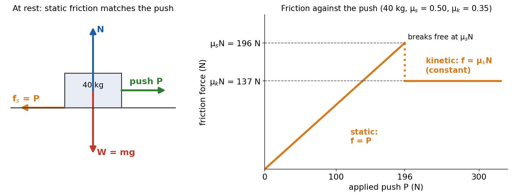
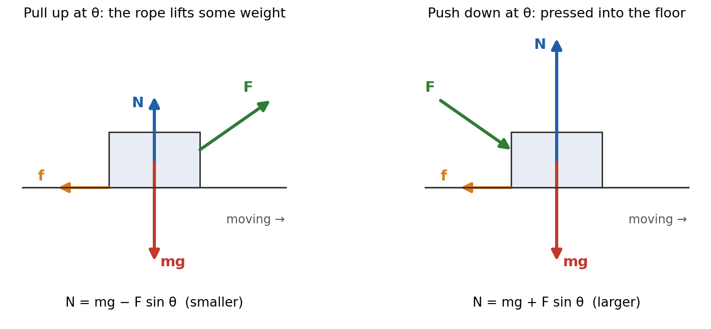
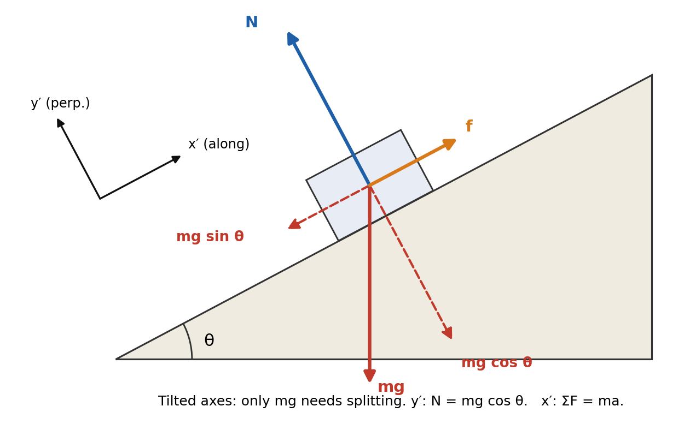
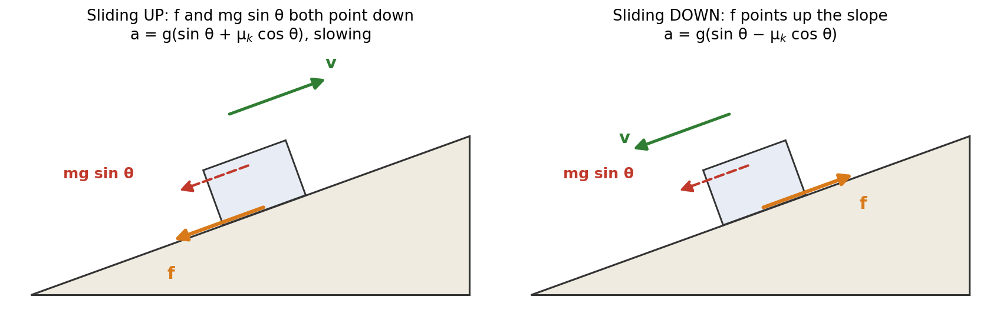
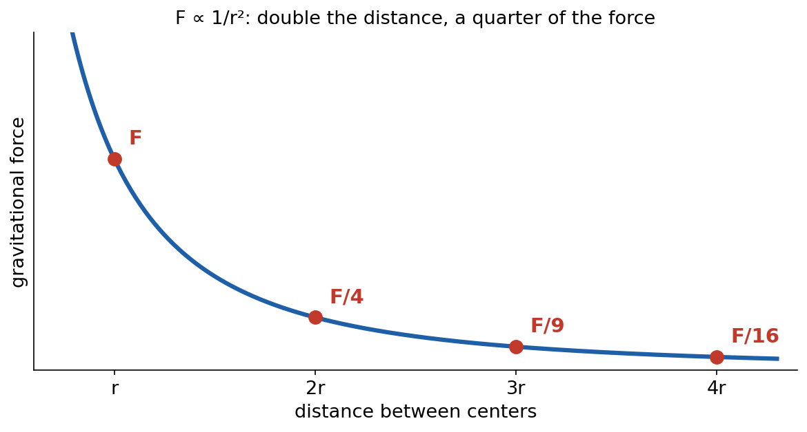
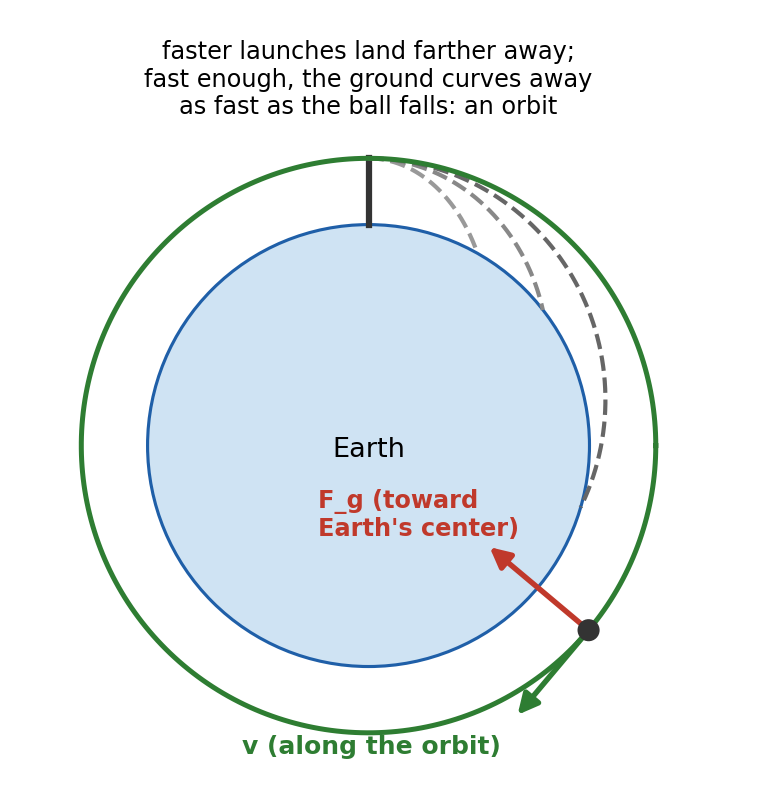
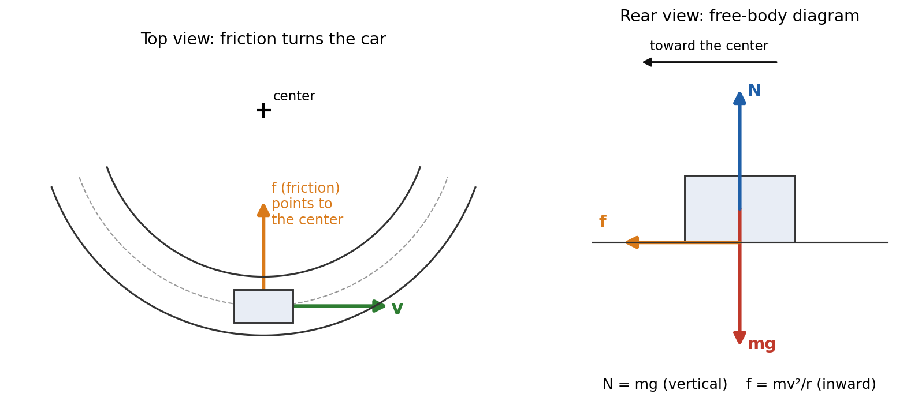
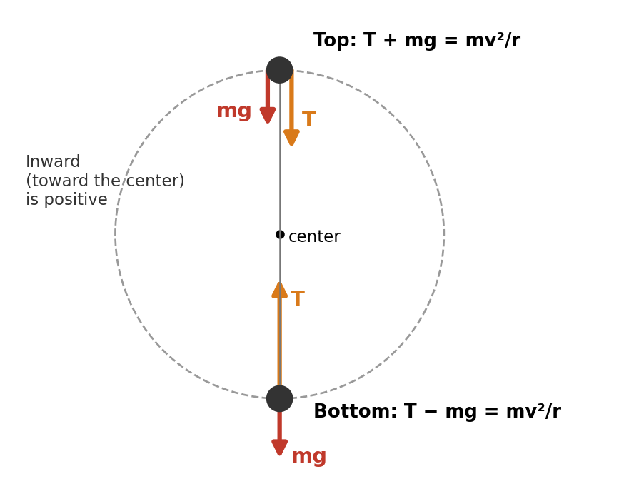
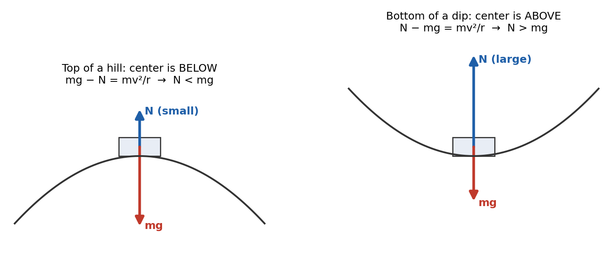
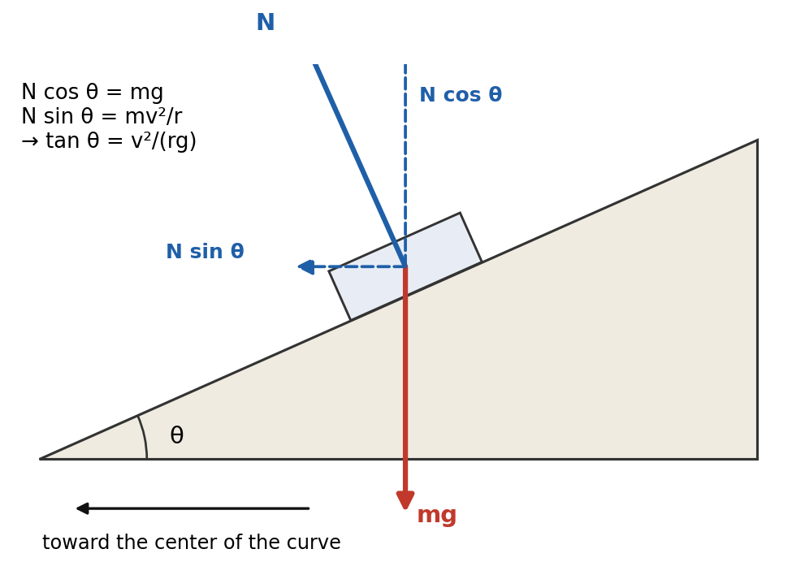

# Session 10 — Unit 2 Quiz Prep: Friction, Inclines, Universal Gravitation and Circular Motion

**Duration:** 80 minutes\
**Continues from:** Session 6 (free-body diagrams, static and kinetic friction, inclined planes) and Session 9 (circular motion, universal gravitation, orbits).\
**School unit:** the Unit 2 quiz. The topics are static friction, kinetic friction, inclined planes, universal gravitation and circular motion, plus a few smaller Newton's-laws questions. **Hooke's law is not on this quiz.**\
**Textbooks:**

- HMH *Physics* (the school's main text): Ch 4 "Forces and the Laws of Motion" §4.4 Everyday Forces (friction); Ch 7 "Circular Motion and Gravitation".
- Glencoe *Physics: Principles and Problems*: Ch 5 §5.2 Friction and §5.3 Force and Motion in Two Dimensions (inclines); Ch 6 §6.2 Circular Motion; Ch 7 §7.1–7.2 Gravitation.
- Hewitt *Conceptual Physics*: "Newton's Second Law" (friction), "Gravity", "Satellite Motion".

**Companion materials:** the class slide deck, Practice Quizzes 1–3 with answer keys, the online Unit 2 quiz (245 questions), the flashcards and the Force Lab. The worked examples here use different numbers from the practice quizzes, so those stay fresh for tonight.\
**g = 9.81 m/s²** throughout. **Constants:** $G = 6.67 \times 10^{-11}$ N·m²/kg², $M_E = 5.97 \times 10^{24}$ kg, $R_E = 6.38 \times 10^6$ m.

---

## Lesson Plan

**Objectives.** By the end of this session the student should be able to:

1. Decide whether friction is static or kinetic, and find its size: static friction matches the applied force up to $\mu_s N$; kinetic friction is $\mu_k N$.
2. Find the normal force when it is **not** $mg$: an angled push or pull, an incline, a book on a wall.
3. Resolve the weight on an incline and find the acceleration with and without friction, going up or down, and decide whether a block will slide.
4. Use $F = \dfrac{Gm_1m_2}{r^2}$ for forces, ratios, g on other planets and g at a height.
5. Find the orbital speed and period of a satellite.
6. Solve the six circular-motion setups: flat curve, top and bottom of a vertical circle, hilltop, dip, banked curve.
7. Answer the quick Newton's-laws questions: elevators, third-law pairs, connected objects.

| Time | Segment |
| --- | --- |
| 0–5 min | Warm-up: 3 quick questions |
| 5–20 min | Part 1: static and kinetic friction, the normal force |
| 20–35 min | Part 2: inclined planes |
| 35–48 min | Part 3: universal gravitation and g |
| 48–55 min | Part 4: orbits |
| 55–70 min | Part 5: circular motion, the six setups |
| 70–75 min | Part 6: Newton's laws quick hits |
| 75–80 min | Exit ticket and tonight's practice plan |

**Pacing note.** Friction and inclines carry the most marks and also re-drill free-body diagrams, the weak spot from the midterm. If time runs short, do Worked Examples 1, 3, 8 and 9 in full, read the others as answers only, and keep the exit ticket.

---

## Warm-up (5 min)

1. *You push a box with 20 N and it doesn't move. The most static friction can supply is 80 N. What is the friction force?* → **20 N.** The box is at rest, so the net force is zero and friction exactly matches the push. 80 N is only the limit.
2. *A ball on a string is whirled in a horizontal circle and the string breaks. Which way does the ball go?* → **Along the tangent**, in a straight line (Newton's first law). Not straight outward.
3. *The distance between two masses doubles. What happens to the gravitational force?* → **It becomes ¼ as large**, because $F \propto 1/r^2$.

**Bridge to today:** every question on the quiz is Newton's second law with a different force doing the job. Today we go through each force once, then practice.

---

## Formula Sheet — Unit 2

| Label | Equation | In words |
| --- | --- | --- |
| **F1** | $f_s \le \mu_s N$ | static friction matches the push, up to a maximum $\mu_s N$ |
| **F2** | $f_k = \mu_k N$ | kinetic friction, opposite the sliding, constant |
| **F3** | $N = mg - F\sin\theta$ / $N = mg + F\sin\theta$ | pulling up / pushing down at angle θ on a level floor |
| **F4** | $a = \mu_k g$ | deceleration of anything sliding to a stop on a level floor |
| **I1** | $mg\sin\theta$ along, $mg\cos\theta$ into the slope | the weight resolved on an incline |
| **I2** | $N = mg\cos\theta$ | normal force on an incline |
| **I3** | $a = g(\sin\theta \mp \mu_k\cos\theta)$ | sliding down (−) or slowing on the way up (+) |
| **I4** | $\tan\theta = \mu_s$ ; $\tan\theta = \mu_k$ | about to slip ; sliding at constant velocity |
| **G1** | $F = \dfrac{Gm_1m_2}{r^2}$ | Newton's law of universal gravitation, r center to center |
| **G2** | $g = \dfrac{GM}{r^2}$ | gravitational field strength, $r = R + h$ |
| **G3** | $v = \sqrt{\dfrac{GM}{r}}$ , $T = \dfrac{2\pi r}{v}$ | circular orbit (the satellite's mass cancels) |
| **G4** | $T^2 = \dfrac{4\pi^2}{GM}r^3$ | Kepler's third law |
| **C1** | $a_c = \dfrac{v^2}{r} = \dfrac{4\pi^2 r}{T^2}$ , $v = \dfrac{2\pi r}{T}$ | centripetal acceleration, toward the center |
| **C2** | $\sum F_{in} = \dfrac{mv^2}{r}$ | Newton's second law toward the center |
| **C3** | $v_{max} = \sqrt{\mu_s g r}$ | flat curve |
| **C4** | $v = \sqrt{gr}$ | slowest at the top of a loop; fastest over a hilltop |
| **C5** | $\tan\theta = \dfrac{v^2}{rg}$ | banked curve with no friction |
| **N1** | $N = m(g \pm a)$ | scale reading in an elevator accelerating up (+) or down (−) |

---

## Part 1 — Static and Kinetic Friction (15 min)

### Two kinds of friction (HMH §4.4, Glencoe §5.2)

Friction comes from the two surfaces catching on each other where they touch. It always acts **along** the surface and opposes sliding, or the tendency to slide.

- **Static friction** $f_s$ acts while the surfaces are **not** sliding. It adjusts to whatever is needed to stop sliding, up to a maximum: $f_s \le \mu_s N$.
- **Kinetic friction** $f_k$ acts while the surfaces **are** sliding. It is constant: $f_k = \mu_k N$. It does not depend on the speed or on the area of contact.

μ (mu) is the **coefficient of friction**. It has no units ($\mu = f/N$, newtons over newtons), depends only on the two materials, and usually $\mu_k < \mu_s$.

| Surfaces (typical values) | μ_s | μ_k |
| --- | --- | --- |
| rubber on dry concrete | 0.80 | 0.65 |
| wood on wood | 0.50 | 0.20 |
| steel on steel (dry) | 0.78 | 0.58 |
| steel on steel (oiled) | 0.15 | 0.06 |
| Teflon on steel | 0.04 | 0.04 |

{width=96%}

**The decision rule.** Find N. Find $f_{s,max} = \mu_s N$. Compare the applied force along the surface with it:

- applied force ≤ $\mu_s N$: **it stays at rest**, and $f_s$ = the applied force;
- applied force > $\mu_s N$: **it slides**, friction becomes $f_k = \mu_k N$, and $a = \dfrac{F - f_k}{m}$.

### Worked Example 1: the 40 kg crate

A 40 kg crate sits on a level floor with $\mu_s = 0.50$ and $\mu_k = 0.35$.
(a) A 150 N horizontal push is applied. What is the friction force?
(b) What is the smallest push that starts it moving?
(c) The push is 250 N. Find the acceleration.
(d) You push with exactly the force from (b) and keep pushing with it once the crate moves. Find the acceleration.
(e) The crate slides at 4.0 m/s and you let go. How far does it slide, and for how long?

- $N = mg = 40 \times 9.81 = 392.4$ N. $f_{s,max} = 0.50 \times 392.4 = 196.2$ N. $f_k = 0.35 \times 392.4 = 137.3$ N.
- **(a)** 150 N < 196.2 N, so it stays at rest. Static friction equals the push: **150 N**, opposite the push.
- **(b)** The push must just exceed $f_{s,max}$: **196 N**.
- **(c)** 250 N > 196.2 N, so it slides: $a = \dfrac{250 - 137.3}{40} = \dfrac{112.7}{40}$ = **2.82 m/s²**.
- **(d)** Once it moves, friction drops from 196.2 N to 137.3 N, so the same push now accelerates it: $a = \dfrac{196.2 - 137.3}{40}$ = **1.47 m/s²**. Shortcut: $a = (\mu_s - \mu_k)g = 0.15 \times 9.81 = 1.47$ m/s².
- **(e)** Only friction acts along the floor: $\mu_k mg = ma$, so $a = \mu_k g = 0.35 \times 9.81 = 3.43$ m/s² (slowing). The mass cancels.
  $d = \dfrac{v^2}{2a} = \dfrac{4.0^2}{2 \times 3.43}$ = **2.33 m**, and $t = \dfrac{v}{a} = \dfrac{4.0}{3.43}$ = **1.17 s**.

### The normal force is not always mg

{width=92%}

N is whatever the surface must push to stop the object sinking into it. Write $\sum F_y = 0$ every time:

- **Pull up at θ:** $N + F\sin\theta - mg = 0$, so $N = mg - F\sin\theta$.
- **Push down at θ:** $N - F\sin\theta - mg = 0$, so $N = mg + F\sin\theta$.
- Only the horizontal part, $F\cos\theta$, moves the object along the floor.

### Worked Example 2: pulling a trunk at an angle

A 45 kg trunk is pulled across a floor by a strap at 35° above the horizontal with a 200 N force. $\mu_k = 0.30$. Find (a) N, (b) the friction, (c) the acceleration. (d) What if the same 200 N pushed **down** at 35° instead?

- $mg = 45 \times 9.81 = 441$ N. $F\sin 35° = 200 \times 0.574 = 115$ N. $F\cos 35° = 200 \times 0.819 = 163.8$ N.
- **(a)** $N = 441 - 115$ = **327 N**.
- **(b)** $f_k = 0.30 \times 327$ = **98.0 N**.
- **(c)** $a = \dfrac{163.8 - 98.0}{45}$ = **1.46 m/s²**. (Using N = mg gives friction 132 N and a = 0.70 m/s²: that is the classic wrong answer.)
- **(d)** $N = 441 + 115 = 556$ N, so $f_k = 0.30 \times 556 = 167$ N, which is **more** than the 163.8 N forward part. The trunk would slow down: pushing down at this angle cannot keep it moving.

### Static friction can push you forward

Static friction opposes **slipping**, not motion. When you walk, your foot pushes back on the ground, so the ground pushes your foot **forward** (Newton's third law), and the foot doesn't slip, so it is static friction. The same holds for a car's tires when it speeds up, and for a crate riding on an accelerating truck: friction points forward, in the direction of the acceleration.

Two standard results come from this:

- **Largest acceleration without slipping:** $\mu_s mg = ma$, so $a_{max} = \mu_s g$. With $\mu_s = 0.80$: 7.85 m/s².
- **Book held against a wall** by a horizontal push F: the push is the normal force (N = F), and friction holds the weight: $\mu_s F \ge mg$, so $F \ge \dfrac{mg}{\mu_s}$.

---

## Part 2 — Inclined Planes (15 min)

### Derivation: resolving the weight (Glencoe §5.3)

{width=78%}

**Step 1: tilt the axes.** The acceleration is along the slope, so put x′ along the slope and y′ perpendicular to it. N and friction already lie on these axes; only mg needs splitting.

**Step 2: find the angle.** The perpendicular to the slope is tilted from the vertical by the same angle θ that the slope is tilted from the horizontal. So the angle between mg and the y′ axis is θ.

**Step 3: resolve.** Along the slope (downhill): $mg\sin\theta$. Into the slope: $mg\cos\theta$. *Sin to slide, cos to squeeze.*

**Step 4: the perpendicular axis.** The block doesn't leave or sink into the surface, so $a_{y'} = 0$: $N - mg\cos\theta = 0$, which gives $N = mg\cos\theta$, less than mg.

**Step 5: along the slope.** Sliding down with kinetic friction pointing up the slope:
$mg\sin\theta - \mu_k mg\cos\theta = ma$, so $a = g(\sin\theta - \mu_k\cos\theta)$.

The mass cancels. **Limit checks:** with no friction, $a = g\sin\theta$; θ = 0 gives a = 0 (a flat floor); θ = 90° gives a = g (free fall).

**Will it slide?** A block at rest stays only if the slope component can be held by static friction:
$mg\sin\theta \le \mu_s mg\cos\theta$, that is $\tan\theta \le \mu_s$.

- Tilt a board until a block just slips: $\mu_s = \tan\theta$ (the **angle of repose**, a lab method for $\mu_s$).
- A block sliding down at **constant velocity** has balanced forces: $\mu_k = \tan\theta$.
- A block **at rest** on a slope has $f_s = mg\sin\theta$ up the slope, not $\mu_s mg\cos\theta$.

### Worked Example 3: a box on a ramp that is raised

A 12 kg box rests on a ramp with $\mu_s = 0.60$ and $\mu_k = 0.40$.
(a) At 28°, does it slide? If not, find the friction force.
(b) At what angle does it start to slip?
(c) The ramp is raised to 35°. Find the box's acceleration.

- $mg = 12 \times 9.81 = 118$ N.
- **(a)** $mg\sin 28° = 118 \times 0.469 = 55.3$ N. $N = mg\cos 28° = 118 \times 0.883 = 104$ N, so $f_{s,max} = 0.60 \times 104 = 62.4$ N. 55.3 N < 62.4 N, so it **stays at rest**, with friction **55.3 N up the slope**. (Check with the shortcut: $\tan 28° = 0.53 < 0.60$.)
- **(b)** $\theta = \tan^{-1}(0.60)$ = **31.0°**.
- **(c)** $\tan 35° = 0.70 > 0.60$, so it slides. $a = 9.81(\sin 35° - 0.40\cos 35°) = 9.81(0.574 - 0.328) = 9.81 \times 0.246$ = **2.41 m/s²** down the slope.
  (In forces: $mg\sin 35° = 67.5$ N, $f_k = 0.40 \times 96.4 = 38.6$ N, $a = \dfrac{67.5 - 38.6}{12} = 2.41$ m/s². ✓)

### Going up versus coming down

{width=96%}

- **Sliding up** (after a push): friction points **down** the slope, with $mg\sin\theta$. Deceleration $a = g(\sin\theta + \mu_k\cos\theta)$.
- **Sliding down:** friction points **up** the slope. $a = g(\sin\theta - \mu_k\cos\theta)$.
- **Pushing up at constant speed:** $F = mg\sin\theta + \mu_k mg\cos\theta$.

### Worked Example 4: launched up a slope

A block is given a push and slides up a 20° incline at 5.0 m/s. $\mu_k = 0.15$ and $\mu_s = 0.25$.
(a) Find its deceleration on the way up. (b) How far up does it go? (c) Does it slide back? (d) Find its acceleration coming down. (e) How fast is it moving when it gets back to the start?

- **(a)** $a = 9.81(\sin 20° + 0.15\cos 20°) = 9.81(0.342 + 0.141) = 9.81 \times 0.483$ = **4.74 m/s²** (down the slope).
- **(b)** $d = \dfrac{v^2}{2a} = \dfrac{5.0^2}{2 \times 4.74}$ = **2.64 m**.
- **(c)** $\tan 20° = 0.364 > \mu_s = 0.25$, so static friction can't hold it: it **slides back down**.
- **(d)** $a = 9.81(0.342 - 0.141) = 9.81 \times 0.201$ = **1.97 m/s²**.
- **(e)** $v = \sqrt{2ad} = \sqrt{2 \times 1.97 \times 2.64}$ = **3.23 m/s**. Less than 5.0 m/s, because friction removed energy on both legs.

---

## Part 3 — Universal Gravitation (13 min)

### The law (HMH Ch 7, Glencoe §7.1)

Every mass attracts every other mass with a force

$$F = \dfrac{Gm_1m_2}{r^2}, \qquad G = 6.67 \times 10^{-11}\ \text{N·m}^2\text{/kg}^2$$

- **r is measured center to center.** A sphere pulls as if all its mass were at its center. For a satellite, $r = R_E + h$.
- The force is **always attractive** and acts across empty space.
- The two forces are a **third-law pair**: Earth pulls the Moon exactly as hard as the Moon pulls Earth. The Moon accelerates more because it has less mass.
- **G is tiny**, so gravity is noticeable only when one mass is enormous. Cavendish first measured G (1798) with a torsion balance.

### The inverse-square law and ratio problems

{width=70%}

Most quiz questions on gravitation are ratios. **New force = old force × (mass factors) ÷ (distance factor)².**

| Change | Working | New force |
| --- | --- | --- |
| distance doubled | $1/2^2$ | F/4 |
| distance tripled | $1/3^2$ | F/9 |
| distance halved | $1/(1/2)^2$ | 4F |
| one mass doubled | $2/1$ | 2F |
| both masses doubled, distance doubled | $(2 \times 2)/2^2$ | F |
| one mass tripled, distance doubled | $3/2^2$ | 3F/4 |

### Worked Example 5: you and the Earth

Find the gravitational force between Earth and a 65 kg student standing on its surface, and compare it with mg.

- $F = \dfrac{(6.67 \times 10^{-11})(5.97 \times 10^{24})(65)}{(6.38 \times 10^6)^2} = \dfrac{2.588 \times 10^{16}}{4.070 \times 10^{13}}$ = **636 N**.
- $mg = 65 \times 9.81 = 638$ N. They agree: **your weight is the gravitational force of the Earth on you.** (The small difference is because Earth spins and isn't a perfect sphere. Use 9.81.)

### Derivation: where g comes from

The weight of a mass m at distance r from a planet's center is its gravitational force: $mg = \dfrac{GMm}{r^2}$. The m cancels:

$$g = \dfrac{GM}{r^2}$$

So g depends only on the planet's mass and how far you are from its center: $g \propto \dfrac{M}{r^2}$. Its units are N/kg, which equal m/s².

### Worked Example 6: g elsewhere

(a) A planet has 3 times Earth's mass and 1.5 times its radius. Find g on its surface.
(b) Find g 2000 km above Earth's surface.
(c) At what height above Earth's surface is g one ninth of its surface value?

- **(a)** $g = 9.81 \times \dfrac{3}{1.5^2} = 9.81 \times 1.33$ = **13.1 m/s²**.
- **(b)** $r = 6.38 \times 10^6 + 2.00 \times 10^6 = 8.38 \times 10^6$ m. $g = \dfrac{(6.67 \times 10^{-11})(5.97 \times 10^{24})}{(8.38 \times 10^6)^2}$ = **5.67 m/s²**.
- **(c)** $g \propto 1/r^2$, so one ninth needs $r = 3R_E$. The height is $h = r - R_E = 2R_E$ = **1.28 × 10⁷ m** (12,800 km). The trap answer is 3R_E: that is the distance from the center, not the height.

**Mass versus weight.** A 70 kg astronaut has a mass of 70 kg everywhere. Her weight, mg, changes with g: about 113 N on the Moon (g = 1.62 m/s²).

---

## Part 4 — Orbits (7 min)

{width=60%}

### Derivation: orbital speed and period

For a circular orbit, gravity is the centripetal force:

$$\dfrac{GMm}{r^2} = \dfrac{mv^2}{r} \quad\Rightarrow\quad v = \sqrt{\dfrac{GM}{r}}$$

- The satellite's mass m **cancels**: a wrench and the ISS in the same orbit move at the same speed.
- A **higher** orbit (larger r) is **slower**.
- The period is $T = \dfrac{2\pi r}{v}$. Substituting v and squaring gives **Kepler's third law**, $T^2 = \dfrac{4\pi^2}{GM}r^3$: higher orbits also take longer.

### Worked Example 7: a satellite 1,500 km up

Find the orbital speed and period of a satellite 1,500 km above Earth's surface.

- $r = 6.38 \times 10^6 + 1.50 \times 10^6 = 7.88 \times 10^6$ m.
- $GM_E = (6.67 \times 10^{-11})(5.97 \times 10^{24}) = 3.98 \times 10^{14}$ m³/s².
- $v = \sqrt{\dfrac{3.98 \times 10^{14}}{7.88 \times 10^6}}$ = **7,110 m/s**.
- $T = \dfrac{2\pi(7.88 \times 10^6)}{7110} = 6960$ s = **116 min**.

**Kepler ratio, no G needed:** a planet with 9 times the orbital radius has $T \propto r^{3/2}$, so its year is $9^{1.5}$ = 27 times as long.

**Why astronauts float.** At the ISS (400 km up) g is still 8.66 m/s², 88% of the surface value. The astronauts and the station fall around Earth together, so nothing presses on anything: **apparent weightlessness**, not zero gravity.

---

## Part 5 — Circular Motion (15 min)

### Accelerating at constant speed (HMH Ch 7, Glencoe §6.2)

An object moving in a circle at constant speed is **accelerating**, because the direction of its velocity keeps changing. The acceleration points to the **center**:

$$a_c = \dfrac{v^2}{r} = \dfrac{4\pi^2 r}{T^2}, \qquad v = \dfrac{2\pi r}{T}$$

By Newton's second law there must be a net force toward the center, $\sum F_{in} = \dfrac{mv^2}{r}$. This **centripetal force** is not a new kind of force: it is a job, done by a real force.

| Situation | Who supplies the centripetal force |
| --- | --- |
| car on a flat curve | static friction from the road |
| ball whirled on a string | tension |
| Moon, satellites | gravity |
| loop-the-loop, banked road | the normal force (with gravity) |

If the inward force disappears, the object moves off along the **tangent** (first law). The "thrown outward" feeling in a turning car is your inertia: there is no outward force on you.

**The method:** (1) free-body diagram with real forces only; (2) inward is positive; (3) $\sum F_{in} = \dfrac{mv^2}{r}$, and $\sum F = 0$ in any direction with no motion; (4) solve.

### Worked Example 8: a car on a flat curve

{width=92%}

A 1500 kg car takes a flat curve of radius 60 m on a wet road with $\mu_s = 0.55$.
(a) Find the fastest safe speed. (b) Find the friction force at 15 m/s. (c) What happens at 30 m/s?

- Vertically $N = mg$. Friction is the only horizontal force, so it supplies $\dfrac{mv^2}{r}$, and it can be at most $\mu_s mg$.
- **(a)** $\mu_s mg = \dfrac{mv^2}{r}$, so $v_{max} = \sqrt{\mu_s g r} = \sqrt{0.55 \times 9.81 \times 60} = \sqrt{324}$ = **18.0 m/s**. The mass cancels.
- **(b)** $f = \dfrac{1500 \times 15^2}{60}$ = **5,630 N** (the limit is $0.55 \times 1500 \times 9.81 = 8{,}090$ N, so it holds).
- **(c)** Doubling v multiplies $\dfrac{mv^2}{r}$ by 4: 22,500 N, far more than 8,090 N. The car **skids**, moving off along the tangent toward the outside of the curve.

### Worked Example 9: a ball on a string in a vertical circle

{width=58%}

A 0.60 kg ball swings in a vertical circle on a 1.1 m string.
(a) What is the slowest speed at the top that keeps the string tight?
(b) Find the tension at the top at 4.5 m/s. (c) Find the tension at the bottom at 7.0 m/s.

- $mg = 0.60 \times 9.81 = 5.89$ N.
- **(a)** At the slowest speed T = 0 and gravity alone gives the centripetal force: $mg = \dfrac{mv^2}{r}$, $v = \sqrt{gr} = \sqrt{9.81 \times 1.1}$ = **3.28 m/s**.
- **(b) Top:** both forces point down, toward the center: $T + mg = \dfrac{mv^2}{r}$.
  $T = \dfrac{0.60 \times 4.5^2}{1.1} - 5.89 = 11.0 - 5.89$ = **5.16 N**.
- **(c) Bottom:** T points up (inward), mg down (outward): $T - mg = \dfrac{mv^2}{r}$.
  $T = \dfrac{0.60 \times 7.0^2}{1.1} + 5.89 = 26.7 + 5.89$ = **32.6 N**. The string is most likely to break here.

### Worked Example 10: a hill and a dip

{width=85%}

A 1200 kg car moves at 14 m/s over a hilltop and through a dip, each with radius 35 m. Find the normal force at each, and the speed at which it would leave the road at the top.

- $mg = 1200 \times 9.81 = 11{,}770$ N. $\dfrac{mv^2}{r} = \dfrac{1200 \times 14^2}{35} = 6{,}720$ N.
- **Hilltop** (center below, down is inward): $mg - N = \dfrac{mv^2}{r}$, so $N = 11{,}770 - 6{,}720$ = **5,050 N**. Passengers feel lighter.
- **Dip** (center above, up is inward): $N - mg = \dfrac{mv^2}{r}$, so $N = 11{,}770 + 6{,}720$ = **18,500 N**. Passengers feel heavier.
- **Leaves the road** when N = 0: $v = \sqrt{gr} = \sqrt{9.81 \times 35}$ = **18.5 m/s**.

### The banked curve

{width=72%}

With no friction, only N and mg act. Vertically $N\cos\theta = mg$; toward the center $N\sin\theta = \dfrac{mv^2}{r}$. Dividing the second by the first:

$$\tan\theta = \dfrac{v^2}{rg}$$

**Example:** a curve of radius 90 m is designed for 20 m/s. $\tan\theta = \dfrac{20^2}{90 \times 9.81} = 0.453$, so θ = **24.4°**.

- **Faster** than the design speed: the car tends to slide up and out, so friction acts **down** the slope.
- **Slower:** it tends to slide down and in, so friction acts **up** the slope.

### The six setups in one table

| Setup | Toward the center | Key result |
| --- | --- | --- |
| flat curve | $\mu_s mg = \dfrac{mv^2}{r}$ | $v_{max} = \sqrt{\mu_s g r}$ |
| string, top | $T + mg = \dfrac{mv^2}{r}$ | T = 0 at $v = \sqrt{gr}$ |
| string, bottom | $T - mg = \dfrac{mv^2}{r}$ | largest tension |
| hilltop | $mg - N = \dfrac{mv^2}{r}$ | lighter; airborne at $\sqrt{gr}$ |
| dip | $N - mg = \dfrac{mv^2}{r}$ | heavier |
| banked, no friction | $N\sin\theta = \dfrac{mv^2}{r}$, $N\cos\theta = mg$ | $\tan\theta = \dfrac{v^2}{rg}$ |

**Ratio questions:** double v → 4 times the centripetal force; double r at the same speed → half; double r at the same period → double ($a = 4\pi^2 r/T^2$).

---

## Part 6 — Newton's Laws Quick Hits (5 min)

### The elevator (apparent weight)

A scale reads the normal force. Take up as positive: $N - mg = ma$.

| Elevator | Scale reading | 55 kg student, a = 1.8 m/s² |
| --- | --- | --- |
| accelerating upward | $N = m(g + a)$, more than mg | 55 × 11.61 = **639 N** |
| accelerating downward | $N = m(g - a)$, less than mg | 55 × 8.01 = **441 N** |
| constant velocity, up or down | $N = mg$ | **540 N** |
| free fall (cable cut) | N = 0 | **0** |

"Accelerating upward" includes moving up and speeding up **and** moving down and slowing down.

### Third-law pairs

A pair always involves **two objects that swap places** ("A pushes B" and "B pushes A"), the forces are equal and opposite, and they are the same type of force. They act on different objects, so they never cancel.

- The weight of a book and the table's normal force on it are **not** a pair (same object, different types). The pair to "Earth pulls the book down" is "the book pulls Earth up".
- A truck and a small car collide: the forces on them are **equal**. The car has less mass, so its acceleration (and damage) is larger.
- A horse and cart pull each other equally. They speed up because the ground pushes the horse forward harder than the cart pulls back.

### Connected objects

Treat the **whole system** to find the acceleration (internal tensions cancel), then **one object** to find the tension.

- **Atwood machine**, 4.0 kg and 6.0 kg over a pulley: $a = \dfrac{(m_2 - m_1)g}{m_1 + m_2} = \dfrac{2.0 \times 9.81}{10}$ = **1.96 m/s²**. For the 4.0 kg mass: $T - m_1 g = m_1 a$, $T = 4.0(9.81 + 1.96)$ = **47.1 N**.
- **Table and hanging mass with friction:** a 6.0 kg block on a table with $\mu_k = 0.25$, tied over a pulley to a 3.0 kg hanging mass.
  $a = \dfrac{(m_2 - \mu_k m_1)g}{m_1 + m_2} = \dfrac{(3.0 - 1.5) \times 9.81}{9.0}$ = **1.64 m/s²**.
  Hanging mass: $m_2 g - T = m_2 a$, so $T = 3.0(9.81 - 1.64)$ = **24.5 N**. Check with the block: $T - \mu_k m_1 g = 24.5 - 14.7 = 9.8$ N $= 6.0 \times 1.64$ ✓.

---

## Exit Ticket (3 min)

1. A 10 kg box slides down a frictionless 30° ramp. Find its acceleration.
2. Find the fastest speed for a car on a flat curve of radius 50 m with $\mu_s = 0.60$.
3. A planet has 3 times Earth's mass and 3 times its radius. Find g on its surface.

**Tonight:** flashcards (10 min), Practice Quiz 1 on paper then mark it with the key, and the online mock test until 90% or better.

---

## Practice Problems

*Use g = 9.81 m/s², G = 6.67 × 10⁻¹¹ N·m²/kg², $M_E$ = 5.97 × 10²⁴ kg, $R_E$ = 6.38 × 10⁶ m. Do Q1, Q5, Q13 and Q16 in class if time allows; the rest are homework.*

**Tier 1 — Friction**

1. **Will it move?** A 15 kg box is on a level floor with $\mu_s = 0.45$ and $\mu_k = 0.30$. (a) A 50 N horizontal push is applied. What is the friction force? (b) The push is raised to 80 N. Does the box move? If so, find its acceleration.
2. **Puck:** A hockey puck leaves a stick at 9.0 m/s and slides 45 m before stopping. Find $\mu_k$.
3. **Sled:** A 20 kg sled is pulled by a rope at 25° above the horizontal with a 90 N force. $\mu_k = 0.12$. Find (a) the normal force, (b) the acceleration.
4. **Book on a wall:** A 1.2 kg book is held against a wall by a horizontal push. $\mu_s = 0.35$. Find the smallest push that holds it.

**Tier 2 — Inclines**

5. **Frictionless ramp:** A 6.0 kg block is released from rest on a frictionless 35° ramp. Find (a) the two components of its weight, (b) the normal force, (c) its acceleration, (d) its speed after 2.5 m.
6. **Coin:** A coin on a book cover begins to slide when the cover is tilted to 27°. Find $\mu_s$.
7. **Steady slide:** A 25 kg crate slides down a 30° ramp at constant velocity. Find $\mu_k$ and the friction force.
8. **Push it up:** What force parallel to a 22° ramp pushes an 18 kg crate up it at constant speed if $\mu_k = 0.30$?
9. **Steep board:** A block is placed on a 40° board with $\mu_s = 0.75$ and $\mu_k = 0.55$. Does it slide? If so, find its acceleration.

**Tier 3 — Gravitation and orbits**

10. **Two spheres:** Find the gravitational force between an 800 kg sphere and a 1200 kg sphere whose centers are 4.0 m apart.
11. **Ratios:** Two objects attract with force F. Find the new force if (a) the distance is made 4 times larger, (b) one mass is tripled, the other doubled and the distance tripled, (c) both masses are halved and the distance is halved.
12. **A smaller planet:** A planet has 0.80 times Earth's mass and 0.90 times its radius. Find g there and the weight of a 50 kg student.
13. **Satellite:** A satellite orbits 800 km above Earth's surface. Find g at that height, its orbital speed and its period.

**Tier 4 — Circular motion**

14. **Whirled ball:** A 0.25 kg ball moves in a horizontal circle of radius 0.80 m on a frictionless table, making 2.0 revolutions each second. Find its speed, its centripetal acceleration and the tension.
15. **Hilltop:** An 1100 kg car crosses a hilltop of radius 25 m at 11 m/s. Find the normal force, and the speed at which it would leave the road.
16. **Flat curve:** Find the fastest speed around a flat curve of radius 80 m if $\mu_s = 0.45$.
17. **Loop:** A roller coaster loop has a radius of 9.0 m. (a) Find the slowest speed at the top. (b) A 70 kg rider passes the bottom at 20 m/s. Find the normal force on her and compare it with her weight.
18. **Banked curve:** A curve of radius 150 m is banked at 15°. Find the speed at which no friction is needed.

**Tier 5 — Newton's laws and challenge**

19. **Elevator:** A 70 kg student stands on a scale in an elevator. The scale reads 800 N. Find the elevator's acceleration (size and direction).
20. **Table and pulley:** An 8.0 kg block sits on a table with $\mu_s = 0.40$ and $\mu_k = 0.25$, tied over a pulley to a 4.0 kg hanging mass. (a) Does the block move? (b) If so, find the acceleration and the tension.
21. **Kepler (challenge):** The Moon orbits 3.84 × 10⁸ m from Earth's center with a period of 27.3 days. Without using G, find the period of a satellite 4.22 × 10⁷ m from Earth's center.

---

## Answer Key — Full Step-by-Step Solutions

**Exit ticket**

1. $a = g\sin 30° = 9.81 \times 0.500$ = **4.91 m/s²** (the mass doesn't matter).
2. $v_{max} = \sqrt{\mu_s g r} = \sqrt{0.60 \times 9.81 \times 50}$ = **17.2 m/s**.
3. $g = 9.81 \times \dfrac{3}{3^2}$ = **3.27 m/s²**.

**1. Will it move?**

- $N = 15 \times 9.81 = 147$ N. $f_{s,max} = 0.45 \times 147 = 66.2$ N. $f_k = 0.30 \times 147 = 44.1$ N.
- **(a)** 50 N < 66.2 N, so it stays at rest and friction equals the push: **50 N**.
- **(b)** 80 N > 66.2 N, so it slides: $a = \dfrac{80 - 44.1}{15}$ = **2.39 m/s²**.

**2. Puck**

- $v^2 = u^2 - 2ad$ with v = 0: $a = \dfrac{u^2}{2d} = \dfrac{81}{90} = 0.900$ m/s².
- Friction is the only horizontal force: $\mu_k mg = ma$, so $\mu_k = \dfrac{a}{g} = \dfrac{0.900}{9.81}$ = **0.092**.

**3. Sled**

- **(a)** $N = mg - F\sin 25° = 196.2 - 90 \times 0.423 = 196.2 - 38.0$ = **158 N**.
- **(b)** $f_k = 0.12 \times 158 = 19.0$ N. $F\cos 25° = 90 \times 0.906 = 81.6$ N. $a = \dfrac{81.6 - 19.0}{20}$ = **3.13 m/s²**.

**4. Book on a wall**

- N = F (the push). Friction must hold the weight: $\mu_s F \ge mg$.
- $F \ge \dfrac{mg}{\mu_s} = \dfrac{1.2 \times 9.81}{0.35} = \dfrac{11.8}{0.35}$ = **33.6 N**.

**5. Frictionless ramp**

- $mg = 6.0 \times 9.81 = 58.9$ N.
- **(a)** Along: $58.9 \times \sin 35° = 58.9 \times 0.574$ = **33.8 N**. Into the slope: $58.9 \times 0.819$ = **48.2 N**.
- **(b)** $N = mg\cos\theta$ = **48.2 N**.
- **(c)** $a = g\sin 35° = 9.81 \times 0.574$ = **5.63 m/s²**.
- **(d)** $v = \sqrt{2ad} = \sqrt{2 \times 5.63 \times 2.5}$ = **5.30 m/s**.

**6. Coin**

- At the point of slipping, $\mu_s = \tan\theta = \tan 27°$ = **0.51**.

**7. Steady slide**

- Constant velocity: $mg\sin\theta = \mu_k mg\cos\theta$, so $\mu_k = \tan 30°$ = **0.58**.
- Friction balances the slope component: $f_k = mg\sin 30° = 25 \times 9.81 \times 0.500$ = **123 N** up the slope.

**8. Push it up**

- $mg = 18 \times 9.81 = 176.6$ N. Moving up, friction points down the slope.
- $F = mg\sin 22° + \mu_k mg\cos 22° = 176.6 \times 0.375 + 0.30 \times 176.6 \times 0.927 = 66.1 + 49.1$ = **115 N**.

**9. Steep board**

- $\tan 40° = 0.84 > 0.75$, so **it slides**.
- $a = 9.81(\sin 40° - 0.55\cos 40°) = 9.81(0.643 - 0.421) = 9.81 \times 0.222$ = **2.17 m/s²**.

**10. Two spheres**

- $F = \dfrac{(6.67 \times 10^{-11})(800)(1200)}{4.0^2} = \dfrac{6.40 \times 10^{-5}}{16}$ = **4.00 × 10⁻⁶ N**.

**11. Ratios**

- **(a)** $1/4^2$: **F/16**.
- **(b)** $(3 \times 2)/3^2 = 6/9$: **2F/3**.
- **(c)** $(\tfrac{1}{2} \times \tfrac{1}{2})/(\tfrac{1}{2})^2 = 1$: **F** (unchanged).

**12. A smaller planet**

- $g = 9.81 \times \dfrac{0.80}{0.90^2} = 9.81 \times 0.988$ = **9.69 m/s²**.
- Weight $= 50 \times 9.69$ = **484 N**.

**13. Satellite**

- $r = 6.38 \times 10^6 + 0.80 \times 10^6 = 7.18 \times 10^6$ m.
- $g = \dfrac{GM_E}{r^2} = \dfrac{3.98 \times 10^{14}}{(7.18 \times 10^6)^2}$ = **7.72 m/s²**.
- $v = \sqrt{\dfrac{GM_E}{r}} = \sqrt{\dfrac{3.98 \times 10^{14}}{7.18 \times 10^6}}$ = **7,450 m/s**.
- $T = \dfrac{2\pi r}{v} = \dfrac{2\pi(7.18 \times 10^6)}{7450} = 6060$ s = **101 min**.

**14. Whirled ball**

- 2.0 rev/s means T = 0.50 s. $v = \dfrac{2\pi r}{T} = \dfrac{2\pi(0.80)}{0.50}$ = **10.1 m/s**.
- $a_c = \dfrac{v^2}{r} = \dfrac{10.05^2}{0.80}$ = **126 m/s²**.
- The tension supplies the centripetal force: $T = ma_c = 0.25 \times 126$ = **31.6 N**.

**15. Hilltop**

- $mg = 1100 \times 9.81 = 10{,}790$ N. $\dfrac{mv^2}{r} = \dfrac{1100 \times 11^2}{25} = 5{,}320$ N.
- $N = mg - \dfrac{mv^2}{r} = 10{,}790 - 5{,}320$ = **5,470 N**.
- Leaves the road at $v = \sqrt{gr} = \sqrt{9.81 \times 25}$ = **15.7 m/s**.

**16. Flat curve**

- $v_{max} = \sqrt{\mu_s g r} = \sqrt{0.45 \times 9.81 \times 80} = \sqrt{353}$ = **18.8 m/s**.

**17. Loop**

- **(a)** $v_{min} = \sqrt{gr} = \sqrt{9.81 \times 9.0}$ = **9.40 m/s**.
- **(b)** At the bottom, $N - mg = \dfrac{mv^2}{r}$: $N = 70 \times 9.81 + \dfrac{70 \times 20^2}{9.0} = 687 + 3111$ = **3,800 N**, about **5.5 times** her weight (687 N).

**18. Banked curve**

- $v = \sqrt{rg\tan\theta} = \sqrt{150 \times 9.81 \times \tan 15°} = \sqrt{150 \times 9.81 \times 0.268}$ = **19.9 m/s**.

**19. Elevator**

- $N - mg = ma$, so $a = \dfrac{N}{m} - g = \dfrac{800}{70} - 9.81 = 11.43 - 9.81$ = **1.62 m/s² upward**.
- The elevator is either speeding up on the way up or slowing down on the way down.

**20. Table and pulley**

- **(a)** The hanging weight is $4.0 \times 9.81 = 39.2$ N. The most static friction can give is $0.40 \times 8.0 \times 9.81 = 31.4$ N. 39.2 > 31.4, so **it moves**.
- **(b)** $a = \dfrac{(m_2 - \mu_k m_1)g}{m_1 + m_2} = \dfrac{(4.0 - 2.0) \times 9.81}{12}$ = **1.64 m/s²**.
  Hanging mass: $T = m_2(g - a) = 4.0(9.81 - 1.64)$ = **32.7 N**. Check with the block: $32.7 - 0.25 \times 8.0 \times 9.81 = 32.7 - 19.6 = 13.1$ N $= 8.0 \times 1.64$ ✓.

**21. Kepler**

- $T \propto r^{3/2}$, so $T_{sat} = 27.3 \times \left(\dfrac{4.22 \times 10^7}{3.84 \times 10^8}\right)^{1.5} = 27.3 \times (0.110)^{1.5} = 27.3 \times 0.0364$ = **0.995 days**, about **24 hours**. This is the geostationary orbit.

---

## Most common mistakes

1. **Writing $f = \mu_s N$ for a box that isn't moving.** Static friction equals the push; $\mu_s N$ is only the limit.
2. **Using N = mg with an angled force or on an incline.** Always get N from the perpendicular direction first.
3. **Keeping $\mu_s$ after the object starts sliding.** Moving means $\mu_k$.
4. **Drawing $mg\sin\theta$ as an extra force** on top of mg, or drawing a forward "force of motion".
5. **Getting friction's direction wrong on an incline.** It opposes the sliding, so it flips when the block goes up.
6. **Forgetting to square r**, or using the height instead of the distance from the center.
7. **Drawing a centripetal or "centrifugal" arrow.** The centripetal force is the net inward force made of the real forces.
8. **Signs in a vertical circle.** At the top, tension and weight both point inward (down).
9. **Saying there is no gravity in orbit.** Astronauts float because they are in free fall.

---

## Quiz-day checklist

- [ ] Calculator in **degree** mode.
- [ ] Write the formula sheet from memory in the first minute if scratch paper is allowed.
- [ ] Free-body diagram first, for every force problem.
- [ ] Ask: is it moving? (static or kinetic) Is there an angle? (N ≠ mg) Which way is the center? (inward positive)
- [ ] Answers to 3 significant figures, with units and a direction.

---

## Notes for next session

- **Session 11:** go through the Unit 2 quiz paper question by question; redo every missed question type with fresh numbers from the online bank.
- If Hooke's law is taught after the quiz, add it to Session 11. Otherwise it comes with elastic potential energy in Session 12.
- **Session 8 (work and energy)** opens the next unit; confirm with Dhairya whether the class goes to energy or momentum next.
